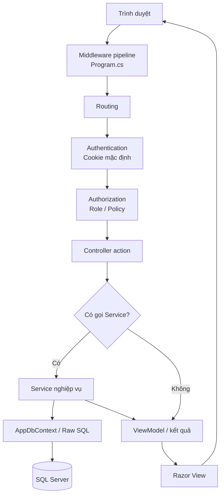
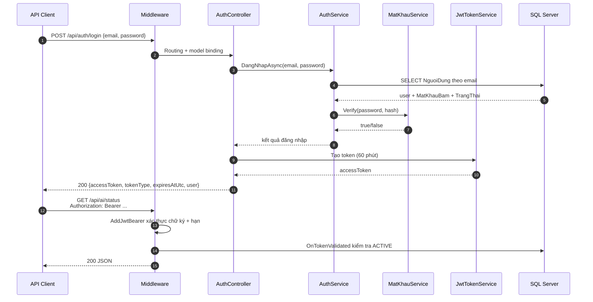
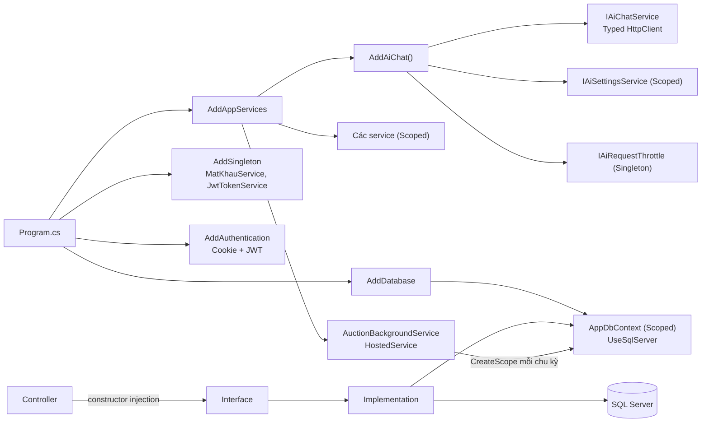
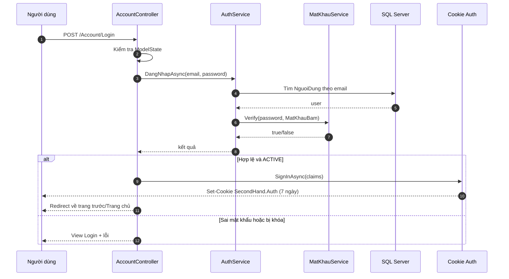
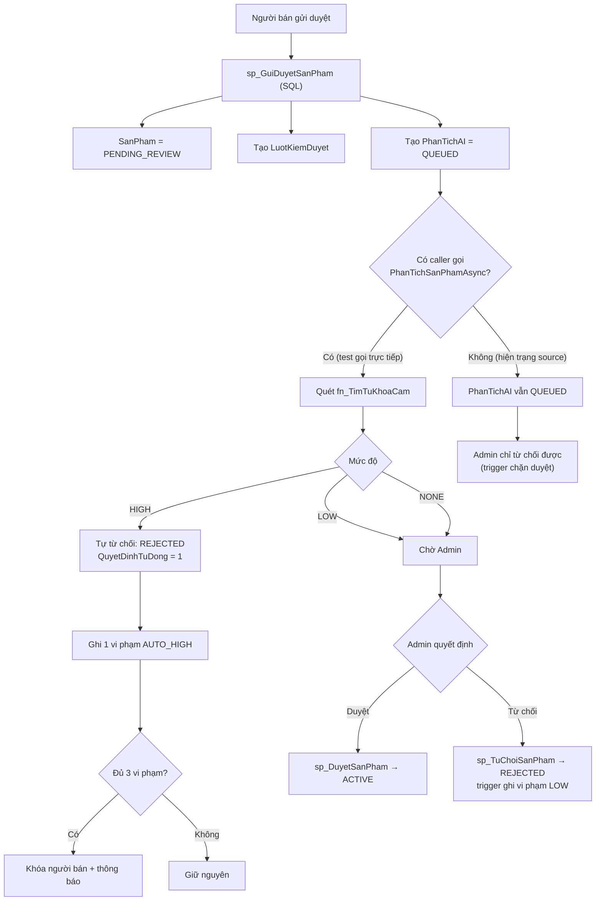
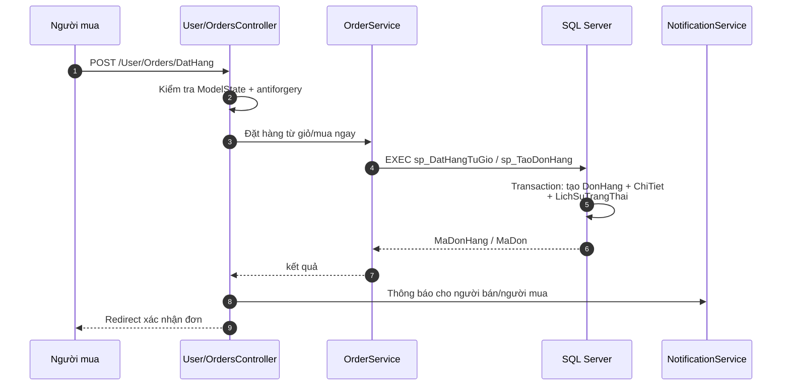
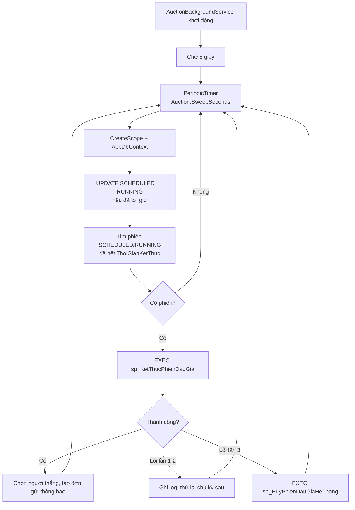
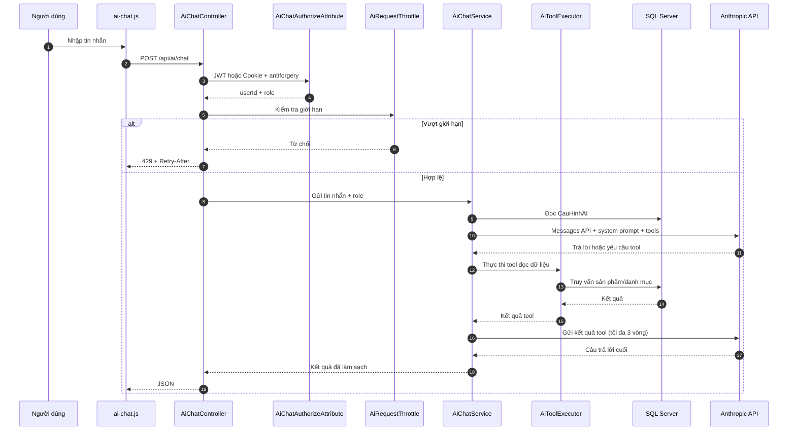

# Hướng dẫn cấu trúc và đọc source code — Secondhand Marketplace

> Tài liệu này được lập bằng cách đọc trực tiếp source code đang có trong repository.
> Mọi mô tả dưới đây bám theo file thật; khi tài liệu cũ trong `docs/` hoặc `README.md`
> khác với source, tài liệu ghi rõ và ưu tiên source code.
>
> Thời điểm khảo sát: 06/11/2026. Không có file source nào bị sửa, đổi tên hay di chuyển
> trong quá trình lập tài liệu.

## Quy ước trạng thái

| Nhãn | Ý nghĩa |
|---|---|
| **Đã triển khai** | Có controller/service/entity/view/SQL và có đường gọi thực tế trong source. |
| **Một phần** | Có code hoặc cấu trúc nhưng thiếu một mắt nối, thiếu UI, hoặc chỉ chạy được với dữ liệu seed. |
| **Chưa triển khai** | Chỉ có file rỗng/placeholder hoặc chỉ có tên, không có xử lý nghiệp vụ. |
| **Chưa đủ bằng chứng** | Không tìm thấy caller, bảng, hoặc cấu hình tương ứng trong source. |

## Mục lục

1. [A. Tổng quan kiến trúc](#a-tổng-quan-kiến-trúc)
2. [B. Sơ đồ cấu trúc thư mục](#b-sơ-đồ-cấu-trúc-thư-mục)
3. [C. Giải thích từng thư mục và file](#c-giải-thích-từng-thư-mục-và-file)
4. [D. Phân tích theo chức năng](#d-phân-tích-theo-chức-năng)
5. [E. Sơ đồ luồng xử lý](#e-sơ-đồ-luồng-xử-lý)
6. [F. Hướng dẫn tìm file khi cần sửa code](#f-hướng-dẫn-tìm-file-khi-cần-sửa-code)
7. [G. Các điểm lệch giữa tài liệu cũ và source](#g-các-điểm-lệch-giữa-tài-liệu-cũ-và-source)
8. [H. Những phần chưa thể xác định](#h-những-phần-chưa-thể-xác-định)

---

## A. Tổng quan kiến trúc

### A.1. Công nghệ và nền tảng

| Thành phần | Thực tế trong source |
|---|---|
| Runtime / framework | ASP.NET Core MVC, `TargetFramework` = `net10.0`, `Nullable` và `ImplicitUsings` bật. |
| Giao diện | Razor View (`.cshtml`), Bootstrap 5, jQuery, jQuery Validation, một số trang dùng Chart.js qua CDN. |
| Truy cập dữ liệu | Entity Framework Core 10 theo hướng **data-first**; SQL Server là nguồn schema chính. |
| ORM package | `Microsoft.EntityFrameworkCore` 10.0.14, `Microsoft.EntityFrameworkCore.SqlServer` 10.0.14, `Microsoft.EntityFrameworkCore.Design` 10.0.14, `Microsoft.EntityFrameworkCore.Tools` 10.0.14. |
| Xác thực | Cookie Authentication cho MVC; JWT Bearer cho API; BCrypt để băm mật khẩu. |
| Phân quyền | Chỉ hai vai trò `USER` và `ADMIN`; không tách vai trò người mua/người bán. |
| Bảo mật mật khẩu | `BCrypt.Net-Next` 4.0.3. Không dùng ASP.NET Identity (dù project có tham chiếu package `Microsoft.AspNetCore.Identity.EntityFrameworkCore`). |
| JWT | `Microsoft.AspNetCore.Authentication.JwtBearer` 10.0.0, thuật toán HMAC-SHA256. |
| Test | xUnit 2.9.3 + `Microsoft.EntityFrameworkCore.InMemory` 10.0.14. |
| Background job | `AuctionBackgroundService` kế thừa `BackgroundService`, chạy theo chu kỳ. |
| AI | Gọi Anthropic Messages API bằng `HttpClient`; cấu hình runtime lưu trong bảng `CauHinhAI`. |

### A.2. Kiến trúc phân lớp thực tế

Dự án là MVC cổ điển mở rộng thêm tầng Service. **Không có Repository, Unit of Work, MediatR hay CQRS.**

```text
Trình duyệt / API client
        │
        ▼
Middleware pipeline (Program.cs)
  ├─ Exception handler / HSTS (production)
  ├─ Status-code pages (trừ /api)
  ├─ HTTPS redirect
  ├─ Routing
  ├─ Authentication (Cookie mặc định, JWT cho API)
  └─ Authorization
        │
        ▼
Controller (MVC hoặc [ApiController])
  ├─ Nhận Model/ViewModel từ form, query, route, JSON
  ├─ Kiểm tra ModelState / quyền / tham số
  └─ Gọi Service qua interface
        │
        ▼
Service (lớp nghiệp vụ)
  ├─ Dùng AppDbContext cho truy vấn EF
  ├─ Gọi stored procedure / function bằng raw SQL
  ├─ Mở transaction khi cần
  └─ Trả kết quả (ViewModel, record kết quả, bool + lỗi)
        │
        ├──────────────► SQL Server
        │                 ├─ Bảng, constraint, index
        │                 ├─ View
        │                 ├─ Stored procedure
        │                 ├─ Function
        │                 └─ Trigger
        ▼
Razor View (HTML) hoặc JSON (API)
```

Điểm quan trọng:

- Controller **không** truy cập SQL trực tiếp, trừ một số controller admin đọc nhanh `AppDbContext` để lấy danh sách/lọc (ví dụ `UsersController`, `SellersController`, `AuditLogsController`, `NotificationsController`).
- Nghiệp vụ quan trọng (đặt hàng, đấu giá, kiểm duyệt, đổi trạng thái) được đẩy xuống stored procedure để transaction và khóa dữ liệu nằm trong SQL Server.
- Một số quy tắc được lặp lại ở hai nơi: C# để báo lỗi sớm cho UI, SQL để làm chốt chặn cuối. Ví dụ `OrderRules` và `fn_ChuyenTrangThaiDonHangHopLe`; `ModerationDecision.CanApprove` và `trg_LuotKiemDuyet_ChanDuyetViPham`.
- Entity được scaffold từ database, sau đó `AppDbContext` được chỉnh tay để khai báo quan hệ, kiểu decimal và trigger.

### A.3. Vai trò từng loại thành phần

| Thành phần | Vai trò | Ví dụ thực tế |
|---|---|---|
| `Program.cs` | Cấu hình DI, authentication, authorization, middleware và route. | Đăng ký Cookie + JWT, map area route. |
| `AppDbContext` | Ánh xạ bảng/cột tiếng Việt, khai báo quan hệ, precision, trigger. | `DbSet<SanPham> SanPhams`, `HasTrigger("trg_SanPham_ChanRutKhoiDauGia")`. |
| Entity | Đại diện một dòng dữ liệu; là kiểu trả về của EF. | `SanPham`, `DonHang`, `NguoiDung`. |
| ViewModel | Dữ liệu vào/ra của View hoặc API; không ánh xạ trực tiếp bảng. | `ProductSearchVm`, `CheckoutViewModel`, `AiChatRequest`. |
| Service interface | Hợp đồng nghiệp vụ, giúp controller không phụ thuộc implementation. | `IProductService`, `IModerationService`. |
| Service implementation | Chứa nghiệp vụ, transaction, gọi SP/EF. | `ProductService`, `OrderService`, `ModerationService`. |
| Controller | Nhận request, kiểm tra quyền, gọi service, chọn View/JSON. | `ProductsController`, `Admin/ProductsController`. |
| View | Render HTML từ ViewModel; dùng layout và partial dùng chung. | `_Layout.cshtml`, `Areas/Admin/Views/Products/Index.cshtml`. |
| `wwwroot` | Tài nguyên tĩnh: CSS, JS, ảnh, thư viện front-end. | `site.css`, `auction.js`, `ai-chat.js`. |
| `Common` | Helper dùng chung: hằng số vai trò, mở rộng Claims, hiển thị, xử lý lỗi SQL. | `AppRoles`, `ClaimsPrincipalExtensions`, `SqlLoi`. |
| `Security` | Băm mật khẩu và tạo JWT. | `MatKhauService`, `JwtTokenService`. |
| `database` | Schema, constraint, index, view, procedure, function, trigger, seed. | `02_create_tables.sql` … `20_cauhinh_ai.sql`. |
| `tests` | Unit test service bằng EF InMemory và fake. | `ModerationServiceTests`, `OrderServiceTests`. |

### A.4. Luồng HTTP tổng quát

1. Request vào `Program.cs`; middleware xử lý lỗi, HTTPS, routing.
2. `UseAuthentication()` xác thực Cookie (MVC) hoặc JWT (API có chọn scheme).
3. `UseAuthorization()` kiểm tra `[Authorize]`, `[Authorize(Roles = "ADMIN")]`, hoặc attribute tự viết.
4. Route chọn controller/action:
   - API có attribute route như `/api/auth/login`, `/api/ai/chat`.
   - Area route: `/{area}/{controller}/{action}/{id?}`, mặc định controller `Dashboard`, action `Index`.
   - Route mặc định: `/{controller=Home}/{action=Index}/{id?}`.
5. Controller gọi service; service dùng `AppDbContext` hoặc raw SQL/SP.
6. Kết quả trả về:
   - MVC: `View(viewModel)` → Razor render HTML.
   - API: `Ok(...)`, `BadRequest(...)`, `Unauthorized(...)`, `StatusCode(...)` → JSON.
7. Với lỗi HTTP không phải `/api`, `UseStatusCodePagesWithReExecute` chuyển sang `Home/TrangLoi` để hiện trang lỗi thân thiện.

### A.5. Cookie Authentication và JWT

#### Cookie (mặc định cho MVC)

Cấu hình trong `Program.cs`:

| Thuộc tính | Giá trị |
|---|---|
| Scheme mặc định | `CookieAuthenticationDefaults.AuthenticationScheme` |
| LoginPath | `/Account/Login` |
| AccessDeniedPath | `/Account/AccessDenied` |
| Tên cookie | `SecondHand.Auth` |
| HttpOnly | `true` |
| SameSite | `Lax` |
| Hạn | 7 ngày, sliding expiration |
| Kiểm tra mỗi request | `OnValidatePrincipal` truy vấn `NguoiDung` và chỉ chấp nhận `TrangThai = 'ACTIVE'` |

Hệ quả: tài khoản bị khóa sẽ mất hiệu lực phiên đang đăng nhập ngay request kế tiếp, nhưng mỗi request có thêm một truy vấn DB.

Cookie được tạo thủ công trong `AccountController` bằng `HttpContext.SignInAsync` với các claim:
`ClaimTypes.NameIdentifier`, `ClaimTypes.Name`, `ClaimTypes.Email`, `ClaimTypes.Role`.

#### JWT (cho API)

Cấu hình trong `Program.cs`:

| Thuộc tính | Giá trị |
|---|---|
| Scheme | `JwtBearerDefaults.AuthenticationScheme` |
| Issuer | `Jwt:Issuer`, mặc định `SecondHandMarketplace` |
| Audience | `Jwt:Audience`, mặc định `SecondHandMarketplace.Client` |
| Khóa | `Jwt:Key`, bắt buộc ≥ 32 byte, nếu thiếu hoặc ngắn thì ứng dụng ném lỗi khi khởi động |
| Thuật toán | HMAC-SHA256 |
| Hạn token | `Jwt:ExpiresMinutes`, mặc định 60 phút |
| ClockSkew | 30 giây |
| Kiểm tra thêm | `OnTokenValidated` truy vấn DB, chỉ chấp nhận tài khoản `ACTIVE` |

JWT được phát hành bởi `JwtTokenService` với các claim id, email, tên, vai trò. API login nằm ở `POST /api/auth/login`, dùng chung `IAuthService` và BCrypt với MVC login.

#### Thực tế JWT đang được dùng ở đâu?

- `POST /api/auth/login`: phát hành token.
- `POST /api/ai/chat` và `GET /api/ai/status`: nhận **cả JWT và Cookie** thông qua `AiChatAuthorizeAttribute`.
- **Không có controller nào** dùng cú pháp `[Authorize(AuthenticationSchemes = JwtBearerDefaults.AuthenticationScheme)]` như `docs/jwt-api.md` hướng dẫn. Đây là điểm lệch giữa tài liệu và source.
- Không có refresh token, logout API, hay endpoint `me`.

`AiChatAuthorizeAttribute` hoạt động như sau:

1. Nếu có header `Authorization: Bearer ...` và token hợp lệ → cho qua, **bỏ qua antiforgery**.
2. Nếu không có Bearer hoặc Bearer không hợp lệ → thử xác thực Cookie.
3. Nếu chưa đăng nhập → trả `401` JSON.
4. Nếu xác thực bằng Cookie và method không an toàn (POST/PUT/DELETE) → kiểm tra antiforgery.

### A.6. Cấu hình khởi động

Các khóa cấu hình đang được source đọc:

| Khóa | Nơi đọc | Ghi chú |
|---|---|---|
| `ConnectionStrings:DefaultConnection` | `ServiceCollectionExtensions.AddDatabase` | `appsettings.json` trỏ `.\SQLEXPRESS`; `run-db.bat` mặc định `localhost`. |
| `Storage:RootPath` | Không tìm thấy code đọc | Có trong `appsettings.json` nhưng hiện **chưa có** chức năng upload dùng nó. |
| `Auction:SweepSeconds` | `AuctionBackgroundService` | Mặc định 60, tối thiểu 10. Comment trong file ghi "30 giây" là chưa khớp. |
| `Jwt:Issuer`, `Jwt:Audience`, `Jwt:Key`, `Jwt:ExpiresMinutes` | `Program.cs`, `JwtTokenService` | Key hiện là placeholder; không phải secret thật. |
| `Ai:ApiKey`, `Ai:Endpoint`, `Ai:AnthropicVersion`, `Ai:DefaultModel`, `Ai:AllowedModels`, `Ai:DefaultEnabled`, `Ai:DefaultSystemPrompt`, `Ai:MaxTokens`, `Ai:TimeoutSeconds`, `Ai:MaxToolRounds` | `AiOptions.FromConfiguration` | `appsettings.json` không có section `Ai`; phải đặt trong User Secrets/biến môi trường nếu muốn chat hoạt động. |
| `Dashboard:PendingReportsSql` | `DashboardService` | Cho phép thay câu SQL đếm báo cáo chờ; nếu bảng thiếu thì trả `null`. |
| `Logging`, `AllowedHosts` | ASP.NET Core | Cấu hình mặc định. |

Project có `<UserSecretsId>` trong `.csproj`, phù hợp để chứa `Jwt:Key` và `Ai:ApiKey` khi phát triển.

---

## B. Sơ đồ cấu trúc thư mục

Sơ đồ dưới đây phản ánh các file **đang được Git theo dõi**. Thư mục `wwwroot/lib` là thư viện third-party được vendor sẵn; tài liệu chỉ liệt kê tên thư viện, không liệt kê từng file `.min.js`/`.map`.

```text
Secondhand-Marketplace/
├── .gitignore
├── README.md
├── Secondhand-Marketplace.sln
│
├── database/
│   ├── 01_create_database.sql
│   ├── 02_create_tables.sql
│   ├── 03_constraints.sql
│   ├── 04_indexes.sql
│   ├── 05_views.sql
│   ├── 06_procedures.sql
│   ├── 07_functions.sql
│   ├── 08_triggers.sql
│   ├── 09_seed_data.sql
│   ├── 10_banner_yeuthich.sql
│   ├── 11_danhgia.sql
│   ├── 12_tranhchap_baocao.sql
│   ├── 13_daugia.sql
│   ├── 14_donhang_admin.sql
│   ├── 15_kiemduyet_tukhoa.sql
│   ├── 16_luot_kiem_duyet_tu_choi_he_thong.sql
│   ├── 17_bo_chan_tu_cam_khi_gui_duyet.sql
│   ├── 18_ghi_vi_pham_low_khi_tu_choi.sql
│   ├── 20_cauhinh_ai.sql
│   ├── README.md
│   ├── reset-db.bat
│   ├── run-db.bat
│   └── tests/
│       └── c2_smoke_test.sql
│
├── docs/
│   ├── jwt-api.md
│   ├── PROJECT-STRUCTURE-GUIDE.md      ← tài liệu này
│   └── c/
│       ├── C3-Integration-Report.md
│       ├── c1-product-review-handoff.md
│       ├── c2-moderation-handoff.md
│       └── c3-chatbox-ai-integration.md
│
├── src/
│   └── SecondHandMarketplace.Web/
│       ├── SecondHandMarketplace.Web.csproj
│       ├── Program.cs
│       ├── appsettings.json
│       ├── appsettings.Example.json
│       ├── Properties/
│       │   └── launchSettings.json
│       │
│       ├── Areas/
│       │   ├── _ViewImports.cshtml
│       │   ├── _ViewStart.cshtml
│       │   ├── Admin/
│       │   │   ├── Controllers/
│       │   │   │   ├── AdminBaseController.cs
│       │   │   │   ├── AiSettingsController.cs
│       │   │   │   ├── AuctionsController.cs
│       │   │   │   ├── AuditLogsController.cs
│       │   │   │   ├── BannersController.cs
│       │   │   │   ├── CategoriesController.cs
│       │   │   │   ├── DashboardController.cs
│       │   │   │   ├── DisputesController.cs
│       │   │   │   ├── ForbiddenKeywordsController.cs
│       │   │   │   ├── NotificationsController.cs
│       │   │   │   ├── OrdersController.cs
│       │   │   │   ├── ProductsController.cs
│       │   │   │   ├── ReportsController.cs
│       │   │   │   ├── ReviewsController.cs
│       │   │   │   ├── SellersController.cs
│       │   │   │   ├── ShopController.cs
│       │   │   │   ├── UsersController.cs
│       │   │   │   └── ViolationsController.cs
│       │   │   └── Views/
│       │   │       ├── AiSettings/Index.cshtml
│       │   │       ├── Auctions/{Details,Index}.cshtml
│       │   │       ├── AuditLogs/Index.cshtml
│       │   │       ├── Banners/Index.cshtml
│       │   │       ├── Categories/Index.cshtml
│       │   │       ├── Dashboard/Index.cshtml
│       │   │       ├── Disputes/{ChiTiet,Index}.cshtml
│       │   │       ├── ForbiddenKeywords/Index.cshtml
│       │   │       ├── Notifications/Index.cshtml
│       │   │       ├── Orders/{Details,Index}.cshtml
│       │   │       ├── Products/{Details,Index}.cshtml
│       │   │       ├── Reports/Index.cshtml
│       │   │       ├── Reviews/Index.cshtml
│       │   │       ├── Sellers/Index.cshtml
│       │   │       ├── Users/Index.cshtml
│       │   │       └── Violations/Index.cshtml
│       │   └── User/
│       │       ├── Controllers/
│       │       │   ├── AuctionsController.cs
│       │       │   ├── CartController.cs
│       │       │   ├── DashboardController.cs
│       │       │   ├── DisputesController.cs
│       │       │   ├── FavoritesController.cs
│       │       │   ├── NotificationsController.cs
│       │       │   ├── OrdersController.cs
│       │       │   ├── ProductsController.cs
│       │       │   ├── ReportsController.cs
│       │       │   ├── ReviewsController.cs
│       │       │   ├── SellerOrdersController.cs
│       │       │   └── UserBaseController.cs
│       │       └── Views/
│       │           ├── Auctions/{Create,Index}.cshtml
│       │           ├── Cart/Index.cshtml
│       │           ├── Dashboard/Index.cshtml
│       │           ├── Disputes/{ChiTiet,Index,Tao}.cshtml
│       │           ├── Favorites/Index.cshtml
│       │           ├── Notifications/Index.cshtml
│       │           ├── Orders/{Checkout,ChiTiet,Index,XacNhan}.cshtml
│       │           ├── Products/Index.cshtml
│       │           ├── Reports/{Index,Tao}.cshtml
│       │           ├── Reviews/Index.cshtml
│       │           ├── SellerOrders/{Details,Index}.cshtml
│       │           └── Shop/Index.cshtml
│       │
│       ├── Common/
│       │   ├── Constants/AppRoles.cs
│       │   ├── ControllerExtensions.cs
│       │   ├── DangNhapHelper.cs
│       │   ├── Extensions/ClaimsPrincipalExtensions.cs
│       │   ├── Extensions/ServiceCollectionExtensions.cs
│       │   ├── HienThi.cs
│       │   ├── KetQua.cs
│       │   ├── OrderRules.cs
│       │   ├── SqlLoi.cs
│       │   └── TextHelper.cs
│       │
│       ├── Controllers/
│       │   ├── AccountController.cs
│       │   ├── HomeController.cs
│       │   ├── ProductsController.cs
│       │   ├── PublicAuctionsController.cs
│       │   └── Api/
│       │       ├── AiChatAuthorizeAttribute.cs
│       │       ├── AiChatController.cs
│       │       └── AuthController.cs
│       │
│       ├── Data/AppDbContext.cs
│       │
│       ├── Models/
│       │   ├── Entities/                    (22 file — chi tiết ở C.5)
│       │   │   ├── AnhSanPham.cs
│       │   │   ├── BaoCao.cs
│       │   │   ├── ChiTietDonHang.cs
│       │   │   ├── CuaHang.cs
│       │   │   ├── DanhMuc.cs
│       │   │   ├── DonHang.cs
│       │   │   ├── GioHang.cs
│       │   │   ├── LichSuTrangThaiDonHang.cs
│       │   │   ├── LichSuTrangThaiSanPham.cs
│       │   │   ├── LichSuViPham.cs
│       │   │   ├── LuotDatGia.cs
│       │   │   ├── LuotKiemDuyet.cs
│       │   │   ├── NguoiDung.cs
│       │   │   ├── NhatKyHeThong.cs
│       │   │   ├── PhanTichAI.cs
│       │   │   ├── PhienDauGia.cs
│       │   │   ├── SanPham.cs
│       │   │   ├── ThanhToan.cs
│       │   │   ├── ThongBao.cs
│       │   │   ├── TinhTrangSanPham.cs
│       │   │   ├── TranhChap.cs
│       │   │   └── TuKhoaCam.cs
│       │   ├── Enums/AppEnums.cs
│       │   ├── ErrorViewModel.cs
│       │   └── ViewModels/
│       │       ├── Account/{ChangePasswordVm,LoginVm,ProfileVm,RegisterVm}.cs
│       │       ├── Admin/{AdminUsersVm,AuditLogsVm,ForbiddenKeywordsVm,ReviewReasonVm}.cs
│       │       ├── Ai/{AiChatRequest,AiSettingsVm}.cs
│       │       ├── Auctions/AuctionVms.cs
│       │       ├── Cart/CartViewModels.cs
│       │       ├── Dashboard/DashboardVms.cs
│       │       ├── Disputes/DisputeViewModels.cs
│       │       ├── Orders/{OrderViewModels,OrderVms}.cs
│       │       ├── PaginationVm.cs
│       │       ├── Paging.cs
│       │       ├── Products/{ProductCardVm,ProductDetailVm,ProductSearchVm}.cs
│       │       ├── Reports/ReportViewModels.cs
│       │       ├── Shop/ShopVm.cs
│       │       └── ViewModels/Notifications/{AdminSendNotificationVm,NotificationListVm}.cs
│       │
│       ├── Security/
│       │   ├── IMatKhauService.cs
│       │   ├── JwtTokenService.cs
│       │   └── MatKhauService.cs
│       │
│       ├── Services/
│       │   ├── Accounts/{IUserAdminService,UserAdminService}.cs
│       │   ├── Ai/{AiChatResult,AiChatService,AiOptions,AiRequestThrottle,AiServiceCollectionExtensions,AiSettings,AiSettingsService,AiToolExecutor,IAiChatService,IAiSettingsService}.cs
│       │   ├── Auctions/{AuctionBackgroundService,AuctionRules,AuctionService,IAuctionService}.cs
│       │   ├── AuditLogs/{AuditLogService,IAuditLogService}.cs
│       │   ├── Auth/{AuthService,IAuthService}.cs
│       │   ├── Banners/{BannerService,IBannerService}.cs
│       │   ├── Carts/{CartService,ICartService}.cs
│       │   ├── Categories/{CategoryService,ICategoryService}.cs
│       │   ├── Dashboard/{DashboardService,IDashboardService}.cs
│       │   ├── Disputes/{DisputeService,IDisputeService}.cs
│       │   ├── Favorites/{FavoriteService,IFavoriteService}.cs
│       │   ├── Moderation/{ForbiddenKeywordService,IForbiddenKeywordService,IKeywordScanner,IModerationService,KeywordMatch,ModerationDecision,ModerationPolicy,ModerationService,SqlKeywordScanner}.cs
│       │   ├── Notifications/{INotificationService,NotificationService}.cs
│       │   ├── OrderManagement/{IOrderManagementService,OrderManagementService}.cs
│       │   ├── Orders/{IOrderService,OrderService}.cs
│       │   ├── ProductReview/{IProductReviewService,ProductReviewService,ReviewDisplay}.cs
│       │   ├── Products/{IProductService,ProductService}.cs
│       │   ├── Reports/{IReportService,ReportService}.cs
│       │   ├── Reviews/{IReviewService,ReviewService}.cs
│       │   └── Shops/{IShopService,ShopService}.cs
│       │
│       ├── Views/
│       │   ├── _ViewImports.cshtml
│       │   ├── _ViewStart.cshtml
│       │   ├── Account/{AccessDenied,ChangePassword,Login,Profile,Register}.cshtml
│       │   ├── Home/Index.cshtml
│       │   ├── Products/{Details,Index}.cshtml
│       │   ├── PublicAuctions/{Details,Index}.cshtml
│       │   └── Shared/
│       │       ├── Error.cshtml
│       │       ├── _AiChatWidget.cshtml
│       │       ├── _BieuDo.cshtml
│       │       ├── _ChiTietDon.cshtml
│       │       ├── _ChuongThongBao.cshtml
│       │       ├── _Layout.cshtml
│       │       ├── _Pager.cshtml
│       │       ├── _Pagination.cshtml
│       │       ├── _ProductCard.cshtml
│       │       ├── _ThongBao.cshtml
│       │       └── _ValidationScriptsPartial.cshtml
│       │
│       └── wwwroot/
│           ├── css/{ai-chat.css,site.css}
│           ├── js/{ai-chat.js,auction.js,site.js}
│           ├── favicon.ico
│           ├── lib/
│           │   ├── bootstrap/
│           │   ├── jquery/
│           │   ├── jquery-validation/
│           │   └── jquery-validation-unobtrusive/
│           └── uploads/.gitkeep
│
└── tests/
    └── SecondHandMarketplace.Tests/
        ├── SecondHandMarketplace.Tests.csproj
        ├── TestFakes.cs
        ├── CartServiceTests.cs
        ├── DisputeServiceTests.cs
        ├── ForbiddenKeywordServiceTests.cs
        ├── ModerationDecisionTests.cs
        ├── ModerationServiceTests.cs
        ├── NotificationServiceTests.cs
        ├── OrderServiceTests.cs
        └── ReportServiceTests.cs
```

Lưu ý về các file không có trong Git:

- `appsettings.Development.json` được tạo local từ `appsettings.Example.json`; README yêu cầu **không commit** file này.
- `bin/`, `obj/`, `.vs/`, file upload thật trong `wwwroot/uploads` bị loại khỏi Git.
- `database/19_*.sql` không tồn tại; số thứ tự nhảy từ 18 sang 20.

---

## C. Giải thích từng thư mục và file

### C.1. Thư mục gốc

| File | Vai trò |
|---|---|
| `README.md` | Quy ước kiến trúc, yêu cầu môi trường, cách chạy DB/app, tài khoản seed, quy định Git. Lưu ý: một số mô tả trong README đã cũ so với source (xem mục G). |
| `Secondhand-Marketplace.sln` | Solution chứa project web và project test. |
| `.gitignore` | Loại trừ `bin/`, `obj/`, `.vs/`, `appsettings.Development.json`, file upload… |

### C.2. Project và cấu hình

| File | Vai trò chính |
|---|---|
| `SecondHandMarketplace.Web.csproj` | Khai báo `net10.0`, nullable, implicit usings, `UserSecretsId`, các package EF/BCrypt/JWT. Có tham chiếu `Microsoft.AspNetCore.Identity.EntityFrameworkCore` nhưng source **không dùng** Identity. |
| `Program.cs` | Điểm khởi động: DI, xác thực Cookie/JWT, middleware, route. |
| `appsettings.json` | Chuỗi kết nối local, `Storage`, `Auction`, `Jwt` placeholder. **Không chứa** section `Ai`, cũng không chứa secret thật. |
| `appsettings.Example.json` | Mẫu cấu hình để copy thành `appsettings.Development.json`. |
| `Properties/launchSettings.json` | Cấu hình profile chạy local (HTTP/HTTPS, biến môi trường). |

#### `Program.cs` — giải thích sâu

Thứ tự đăng ký:

1. `AddControllersWithViews()`: bật MVC controller + Razor view.
2. `AddDatabase(builder.Configuration)`: đăng ký `AppDbContext` dùng SQL Server.
3. `AddAppServices()`: đăng ký toàn bộ service nghiệp vụ.
4. `AddSingleton<IMatKhauService, MatKhauService>()` và `AddSingleton<JwtTokenService>()`.
5. Đọc `Jwt:Key`, ném lỗi nếu thiếu hoặc < 32 byte. Đây là kiểm tra khởi động, không phải kiểm tra mỗi request.
6. `AddAuthentication`: đặt Cookie làm scheme mặc định cho cả authenticate, sign-in và challenge.
7. `.AddCookie(...)`: cấu hình cookie như bảng ở A.5; đăng ký `OnValidatePrincipal`.
8. `.AddJwtBearer(...)`: cấu hình `TokenValidationParameters` và `OnTokenValidated`.
9. Build app, bật exception handler + HSTS ở production.
10. `UseWhen(!/api, UseStatusCodePagesWithReExecute("/Home/TrangLoi"))`: API không bị re-execute sang trang HTML.
11. `UseHttpsRedirection`, `UseRouting`, `UseAuthentication`, `UseAuthorization`.
12. `MapStaticAssets`, `MapControllers`, map area route, map default route.

Điểm cần nhớ khi sửa:

- Nếu thêm scheme xác thực mới, phải đặt đúng thứ tự middleware.
- `DefaultChallengeScheme` là Cookie, nên endpoint `[Authorize]` không chỉ định scheme sẽ redirect về `/Account/Login`, kể cả khi client gửi JWT.
- `MapControllers()` được gọi trước route area/default, nên attribute route của API thắng route quy ước.

#### `ServiceCollectionExtensions.cs` — giải thích sâu

File này có hai hàm:

- `AddDatabase`: `AddDbContext<AppDbContext>` với `UseSqlServer(DefaultConnection)`. Vòng đời mặc định là scoped.
- `AddAppServices`: đăng ký toàn bộ service bằng `AddScoped`, gọi `AddAiChat()`, đăng ký `IKeywordScanner`, và `AddHostedService<AuctionBackgroundService>()`.

Bảng đăng ký thực tế:

| Interface | Implementation | Vòng đời |
|---|---|---|
| `IAuthService` | `AuthService` | Scoped |
| `IUserAdminService` | `UserAdminService` | Scoped |
| `IShopService` | `ShopService` | Scoped |
| `IProductService` | `ProductService` | Scoped |
| `IAuditLogService` | `AuditLogService` | Scoped |
| `INotificationService` | `NotificationService` | Scoped |
| `IAiChatService` | `AiChatService` | Typed `HttpClient` (transient theo `AddHttpClient`) |
| `IAiSettingsService` | `AiSettingsService` | Scoped |
| `IAiRequestThrottle` | `AiRequestThrottle` | Singleton |
| `IKeywordScanner` | `SqlKeywordScanner` | Scoped |
| `IModerationService` | `ModerationService` | Scoped |
| `IForbiddenKeywordService` | `ForbiddenKeywordService` | Scoped |
| `IProductReviewService` | `ProductReviewService` | Scoped |
| `ICartService` | `CartService` | Scoped |
| `IOrderService` | `OrderService` | Scoped |
| `IFavoriteService` | `FavoriteService` | Scoped (lớp rỗng) |
| `IReviewService` | `ReviewService` | Scoped (lớp rỗng) |
| `IReportService` | `ReportService` | Scoped |
| `IDisputeService` | `DisputeService` | Scoped |
| `ICategoryService` | `CategoryService` | Scoped |
| `IBannerService` | `BannerService` | Scoped (lớp rỗng) |
| `IDashboardService` | `DashboardService` | Scoped |
| `IOrderManagementService` | `OrderManagementService` | Scoped |
| `IAuctionService` | `AuctionService` | Scoped |
| `AuctionBackgroundService` | — | Hosted service (singleton do host quản lý) |

Nếu gặp lỗi `Unable to resolve service for type ...`, nguyên nhân thường là quên đăng ký tại đây.

`AiServiceCollectionExtensions.AddAiChat()` đăng ký thêm:

- `TimeProvider.System` singleton (nếu chưa có).
- `IAiRequestThrottle` singleton.
- `IAiSettingsService` scoped.
- Typed `HttpClient` cho `IAiChatService`, đặt `Timeout = InfiniteTimeSpan` vì service tự quản lý timeout bằng `CancellationToken`.

### C.3. `Common` — helper dùng chung

| File | Vai trò | Ai dùng |
|---|---|---|
| `Constants/AppRoles.cs` | Hằng số `Admin = "ADMIN"`, `User = "USER"`. | `AdminBaseController`, `UserBaseController`, service kiểm tra vai trò. |
| `ControllerExtensions.cs` | Helper lấy thông báo thành công/lỗi từ `TempData` cho controller. | Các controller MVC. |
| `DangNhapHelper.cs` | Tạo `ClaimsPrincipal` từ `NguoiDung`. | Được khai báo nhưng **chưa thấy caller** trong source; `AccountController` tự tạo claim. |
| `Extensions/ClaimsPrincipalExtensions.cs` | `GetUserId()`, `LayNguoiDungId()`, `IsAdmin()`… đọc claim. | Controller, view `_ChuongThongBao`. |
| `Extensions/ServiceCollectionExtensions.cs` | Đăng ký DbContext và service. | `Program.cs`. |
| `HienThi.cs` | Helper hiển thị tiếng Việt: trạng thái, ngày, tiền, nhãn. | Razor view. |
| `KetQua.cs` | Kiểu kết quả chung cho API (`Success`, `Message`, `Data`…). | `AiChatController`, API. |
| `OrderRules.cs` | Quy tắc chuyển trạng thái đơn hàng ở phía C#, phản chiếu function SQL. | `OrderService`, `OrderManagementService`. |
| `SqlLoi.cs` | Chuyển mã lỗi SQL Server thành thông báo tiếng Việt. | Các service bắt `SqlException`. |
| `TextHelper.cs` | Chuẩn hóa/cắt chuỗi, hỗ trợ tìm kiếm. | Service và controller. |

### C.4. `Data/AppDbContext.cs` — giải thích sâu

`AppDbContext` kế thừa `DbContext`, chứa 22 `DbSet` tương ứng 22 entity:

`NguoiDungs`, `CuaHangs`, `DanhMucs`, `TinhTrangSanPhams`, `SanPhams`, `AnhSanPhams`,
`GioHangs`, `DonHangs`, `ChiTietDonHangs`, `LichSuTrangThaiDonHangs`, `ThanhToans`,
`LichSuTrangThaiSanPhams`, `LuotKiemDuyets`, `PhanTichAIs`, `TuKhoaCams`, `ThongBaos`,
`NhatKyHeThongs`, `LichSuViPhams`, `PhienDauGias`, `LuotDatGias`, `TranhChaps`, `BaoCaos`.

Các cấu hình quan trọng trong `OnModelCreating`:

- Ánh xạ tên bảng/cột tiếng Việt (ví dụ `SanPham`, `MaSanPham`, `Ten`).
- `decimal` precision `18,2` cho tiền.
- Phần lớn quan hệ dùng `DeleteBehavior.Restrict` để tránh xóa dây chuyền.
- Khai báo trigger để EF không dùng `OUTPUT` khi insert:
  - `SanPham` → `trg_SanPham_ChanRutKhoiDauGia`
  - `AnhSanPham` → `trg_AnhSanPham_GioiHan`
  - `ChiTietDonHang` → `trg_ChiTietDonHang_KiemTra`
  - `LuotKiemDuyet` → `trg_LuotKiemDuyet_KiemTra`
- Unique index trên `LichSuViPham.MaLuotKiemDuyet` (mỗi lượt tối đa một vi phạm).
- Quan hệ 1–1 giữa `LuotKiemDuyet` và `PhanTichAI`.

Lưu ý: `CauHinhAI` **không có entity/DbSet**. `AiSettingsService` đọc/ghi bảng này bằng raw SQL. Nếu scaffold lại entity, có thể thay phần truy vấn mà không đổi interface.

### C.5. `Models/Entities` — 22 entity

| Entity | Bảng | Vai trò và quan hệ chính |
|---|---|---|
| `NguoiDung` | `NguoiDung` | Tài khoản. Khóa chính `MaNguoiDung`; `VaiTro` (`USER`/`ADMIN`), `TrangThai` (`ACTIVE`/`LOCKED`…), `MatKhauBam`, lý do/thời gian khóa. |
| `CuaHang` | `CuaHang` | Cửa hàng của người dùng; `MaNguoiDung` là chủ shop, `TrangThai`, lý do khóa. Quan hệ 1–n với `SanPham`. |
| `DanhMuc` | `DanhMuc` | Danh mục sản phẩm; `DangHienThi`, `ThuTuHienThi`. |
| `TinhTrangSanPham` | `TinhTrangSanPham` | Tình trạng sản phẩm; `Ma`, `Ten`, `DangSuDung`. |
| `SanPham` | `SanPham` | Sản phẩm; `MaCuaHang`, `MaDanhMuc`, `MaTinhTrang`, `Ten`, `ChuoiTimKiem`, `MoTa`, `Gia`, `TrangThai`, `DaXoa`, `LyDoGo`. Quan hệ với ảnh, lượt kiểm duyệt, đơn hàng, đấu giá. |
| `AnhSanPham` | `AnhSanPham` | Ảnh sản phẩm; `DuongDan`, `ThuTu`, `LaAnhChinh`, `DungLuong`. |
| `GioHang` | `GioHang` | Một dòng giỏ hàng; `MaNguoiDung`, `MaSanPham`, `DaChon`, `ThoiGianThem`. |
| `DonHang` | `DonHang` | Đơn hàng; `MaDon`, người nhận, địa chỉ, tiền hàng/phí/tổng, phương thức và trạng thái thanh toán, trạng thái đơn, người hủy/lý do. Quan hệ với chi tiết, lịch sử, thanh toán. |
| `ChiTietDonHang` | `ChiTietDonHang` | Dòng hàng; snapshot `TenSanPham`, `AnhDaiDien`, `Gia`, `DangGiuCho`. |
| `LichSuTrangThaiDonHang` | `LichSuTrangThaiDonHang` | Lịch sử chuyển trạng thái đơn; ai làm, lý do, thời gian. |
| `ThanhToan` | `ThanhToan` | Giao dịch thanh toán; `MaGiaoDich`, phương thức, số tiền, trạng thái. **Chưa có tích hợp cổng thanh toán.** |
| `LichSuTrangThaiSanPham` | `LichSuTrangThaiSanPham` | Lịch sử chuyển trạng thái sản phẩm; ai làm, lý do, thời gian. |
| `LuotKiemDuyet` | `LuotKiemDuyet` | Một lượt gửi duyệt; `KetQuaRule`, `QuyetDinh`, `LyDo`, `MaQuanTriVien`, `ThoiGianQuyetDinh`, `QuyetDinhTuDong`. Quan hệ 1–1 với `PhanTichAI`. |
| `PhanTichAI` | `PhanTichAI` | Kết quả phân tích từ khóa/AI; `TrangThai` (`QUEUED`/`PROCESSING`/`DONE`/`FAILED`), `MucDoTuKhoa` (`NULL`/`NONE`/`LOW`/`HIGH`), điểm rủi ro, đề xuất, giải thích, hash đầu vào. |
| `TuKhoaCam` | `TuKhoaCam` | Từ/cụm từ cấm; `CumTu`, `CumTuChuanHoa`, `Nhom`, `MucDo` (`LOW`/`HIGH`), `DangApDung`. |
| `ThongBao` | `ThongBao` | Thông báo cho người dùng; `Loai`, `TieuDe`, `NoiDung`, `MaThamChieu`, `DaDoc`. |
| `NhatKyHeThong` | `NhatKyHeThong` | Audit log; hành động, loại đối tượng, kết quả, lý do, chi tiết. |
| `LichSuViPham` | `LichSuViPham` | Vi phạm của người bán; `MaLuotKiemDuyet` unique, `MucDo`, `NguonGhiNhan` (`AUTO_HIGH`/`ADMIN_TU_CHOI_LOW`), chi tiết từ khóa. |
| `PhienDauGia` | `PhienDauGia` | Phiên đấu giá; giá niêm yết/khởi điểm/bước giá/hiện tại, người dẫn đầu, thời gian, trạng thái, người thắng, đơn hàng, thông tin hủy. |
| `LuotDatGia` | `LuotDatGia` | Lượt đặt giá; phiên, người đặt, số tiền, thời gian. |
| `TranhChap` | `TranhChap` | Tranh chấp theo đơn; lý do, bằng chứng, phản hồi người bán, trạng thái, phán quyết, admin xử lý. |
| `BaoCao` | `BaoCao` | Báo cáo vi phạm; `LoaiDoiTuong` (`PRODUCT`/`USER`/`SHOP`), `MaDoiTuong`, lý do, mô tả, trạng thái, admin xử lý. |

### C.6. Enums và ViewModels

`Models/Enums/AppEnums.cs` khai báo các enum như `ProductStatus`, `OrderStatus`, `ReportTargetType`, `NotificationType`… Tuy nhiên:

- Không thấy enum nào được dùng trong service/controller nghiệp vụ.
- Giá trị/tên enum không khớp hoàn toàn với chuỗi lưu trong DB (ví dụ `PendingReview` so với `PENDING_REVIEW`; `Behavior` so với `PRODUCT`/`USER`/`SHOP`).
- `_ViewImports` có import namespace nhưng điều này không làm enum được dùng.

Vì vậy khi sửa nghiệp vụ, nên bám theo **chuỗi trạng thái thực tế trong DB/entity**, không dựa vào enum này.

ViewModels chia theo module:

| Thư mục | File tiêu biểu | Dùng cho |
|---|---|---|
| `Account` | `LoginVm`, `RegisterVm`, `ProfileVm`, `ChangePasswordVm` | Form tài khoản. |
| `Products` | `ProductSearchVm`, `ProductCardVm`, `ProductDetailVm` | Tìm kiếm, thẻ sản phẩm, chi tiết. |
| `Cart` | `CartViewModels` | Giỏ hàng. |
| `Orders` | `OrderViewModels`, `OrderVms` | Checkout, danh sách/chi tiết đơn, quản lý đơn. |
| `Auctions` | `AuctionVms` | Danh sách, chi tiết, tạo phiên. |
| `Disputes` | `DisputeViewModels` | Tạo/xử lý tranh chấp. |
| `Reports` | `ReportViewModels` | Tạo/xử lý báo cáo. |
| `Dashboard` | `DashboardVms` | Số liệu và biểu đồ. |
| `Admin` | `AdminUsersVm`, `AuditLogsVm`, `ForbiddenKeywordsVm`, `ReviewReasonVm` | Trang quản trị. |
| `Ai` | `AiChatRequest`, `AiSettingsVm` | Chat API và cấu hình AI. |
| `Shop` | `ShopVm` | Thông tin cửa hàng. |
| `Notifications` | `AdminSendNotificationVm`, `NotificationListVm` | Gửi/xem thông báo. |
| Gốc | `PaginationVm`, `Paging` | Phân trang; xem ghi chú orphan ở mục G. |

### C.7. `Security`

| File | Vai trò |
|---|---|
| `IMatKhauService.cs` | Hợp đồng `Hash`/`Verify`. |
| `MatKhauService.cs` | Dùng BCrypt để băm và kiểm tra mật khẩu. |
| `JwtTokenService.cs` | Tạo JWT HMAC-SHA256, thời hạn lấy từ `Jwt:ExpiresMinutes` (mặc định 60), claim id/email/tên/vai trò. |

### C.8. `Services` — theo từng nhóm

#### Accounts

| File | Vai trò / phương thức chính |
|---|---|
| `IUserAdminService` / `UserAdminService` | `LockUserAsync`, `UnlockUserAsync`: khóa/mở khóa người dùng, bắt buộc lý do, không cho khóa ADMIN, ghi audit. |

#### Auth

| File | Vai trò |
|---|---|
| `IAuthService` / `AuthService` | Đăng ký, đăng nhập, đổi mật khẩu, cập nhật hồ sơ; dùng `AppDbContext` + `IMatKhauService`; trả kết quả có lỗi tiếng Việt. |

#### Products

| File | Vai trò |
|---|---|
| `IProductService` / `ProductService` | Tìm kiếm công khai (chỉ `ACTIVE`, chưa xóa, shop và chủ shop `ACTIVE`), lọc danh mục/tình trạng/giá, lấy chi tiết, ảnh, `CanBuy`. Không phân trang, giới hạn `Take(200)`. |

#### Moderation

| File | Vai trò |
|---|---|
| `IKeywordScanner` / `SqlKeywordScanner` | Quét từ khóa cấm bằng `fn_TimTuKhoaCam`. |
| `KeywordMatch` | Kết quả một từ khóa khớp (cụm từ, nhóm, mức độ). |
| `ModerationPolicy` | Hằng số `NONE`/`LOW`/`HIGH`, trạng thái phân tích, nguồn vi phạm, ngưỡng khóa 3, chuẩn hóa mức độ. |
| `ModerationDecision` | Quyết định từ kết quả quét: `CanApprove`, lý do chặn, JSON bằng chứng, hash SHA-256, giải thích. |
| `IModerationService` / `ModerationService` | `PhanTichSanPhamAsync`: quét tên/mô tả, ghi `PhanTichAI`, tự từ chối nếu HIGH, ghi vi phạm, khóa người bán khi đủ ngưỡng; dùng transaction + `UPDLOCK`/`ROWLOCK`, retry khi trùng unique. |
| `IForbiddenKeywordService` / `ForbiddenKeywordService` | Danh sách/lọc, thêm qua `sp_ThemTuKhoaCam`, cập nhật nhóm/mức độ/ghi chú, bật/tắt, ghi audit. |

#### ProductReview

| File | Vai trò |
|---|---|
| `IProductReviewService` / `ProductReviewService` | Dành cho Admin: danh sách tab chờ duyệt/đang bán, chi tiết kèm thông tin phân tích và vi phạm, duyệt/từ chối/gỡ sản phẩm, lịch sử trạng thái, danh sách vi phạm. Duyệt gọi `sp_DuyetSanPham`; từ chối gọi `sp_TuChoiSanPham`; gỡ gọi `sp_ChuyenTrangThaiSanPham` sang `REMOVED`. Lý do 10–500 ký tự. |
| `ReviewDisplay` | Record/ViewModel phụ để hiển thị lượt duyệt, lịch sử, vi phạm. |

#### Carts

| File | Vai trò |
|---|---|
| `ICartService` / `CartService` | Thêm sản phẩm qua `sp_ThemVaoGio`, đọc giỏ bằng EF, chọn/bỏ chọn từng dòng hoặc cả shop, xóa, đếm số lượng. |

#### Orders

| File | Vai trò |
|---|---|
| `IOrderService` / `OrderService` | Chuẩn bị checkout từ giỏ hoặc mua ngay, đặt hàng qua `sp_DatHangTuGio`/`sp_TaoDonHang`, danh sách/chi tiết đơn, hủy, xác nhận đã nhận, có nhánh EF fallback cho test InMemory. |
| `IOrderManagementService` / `OrderManagementService` | Phía người bán và admin: tìm kiếm, đếm, chi tiết, cập nhật trạng thái qua `sp_CapNhatTrangThaiDon`/`sp_AdminCapNhatTrangThaiDon`, ghi audit; kiểm tra quy tắc bằng `OrderRules`. |

#### Auctions

| File | Vai trò |
|---|---|
| `IAuctionService` / `AuctionService` | Danh sách công khai theo tab, tìm kiếm, chi tiết, trạng thái, đặt giá qua `sp_DatGia`, sản phẩm đủ điều kiện, danh sách/tạo phiên của người bán qua `sp_TaoPhienDauGia`, hủy phiên, admin hủy. |
| `AuctionRules` | Chuẩn hóa trạng thái, kiểm tra quy tắc hiển thị/đặt giá. |
| `AuctionBackgroundService` | Chờ 5 giây sau khởi động; mỗi chu kỳ chuyển `SCHEDULED` → `RUNNING`, chốt phiên hết hạn bằng `sp_KetThucPhienDauGia`; sau 3 lỗi thì hủy bằng `sp_HuyPhienDauGiaHeThong`. Dùng scope riêng cho mỗi lần quét. |

#### Disputes

| File | Vai trò |
|---|---|
| `IDisputeService` / `DisputeService` | Tạo tranh chấp cho đơn của người mua ở `SHIPPING`/`DELIVERED`/`COMPLETED`, chặn tranh chấp đang mở; người bán phản hồi → `PROCESSING`; admin phán quyết `REFUND_BUYER`, `PAY_SELLER`/`RELEASE_SELLER`, `REJECT`; gọi SP cập nhật đơn, gửi thông báo/audit sau commit. |

#### Reports

| File | Vai trò |
|---|---|
| `IReportService` / `ReportService` | Báo cáo `PRODUCT`/`USER`/`SHOP`; lý do ≤ 255, mô tả ≤ 1000; chặn báo cáo trùng đang `PENDING`; admin `DISMISS`/`RESOLVE`; resolve có thể khóa user/shop hoặc gỡ sản phẩm; audit/thông báo. |

#### Notifications

| File | Vai trò |
|---|---|
| `INotificationService` / `NotificationService` | Gửi cho một người hoặc toàn bộ người dùng `ACTIVE`, danh sách phân trang, đếm chưa đọc, đánh dấu đã đọc. Không tự mở transaction. |

#### Shops, Categories, Dashboard, AuditLogs

| File | Vai trò |
|---|---|
| `IShopService` / `ShopService` | Lấy shop theo chủ, tạo qua `sp_TaoCuaHang`, sửa khi shop không `LOCKED`, khóa/mở khóa kèm lý do, audit. |
| `ICategoryService` / `CategoryService` | Danh mục và tình trạng: danh sách, lưu, xóa; nếu đang được dùng thì ẩn thay vì xóa. |
| `IDashboardService` / `DashboardService` | Thống kê người bán/admin từ các view `vw_ThongKeCuaHang`, `vw_ThongKeNguoiBan`, `vw_ThongKeHeThong`; đếm trạng thái, top sản phẩm, biểu đồ 30 ngày/12 tháng, đếm báo cáo chờ. |
| `IAuditLogService` / `AuditLogService` | Ghi nhật ký qua `sp_GhiNhatKy`. |

#### AI

| File | Vai trò |
|---|---|
| `IAiChatService` / `AiChatService` | Gọi Anthropic Messages API, ghép guardrail vào system prompt, giới hạn 1000 ký tự tin nhắn/4000 ký tự trả lời, tối đa 3 vòng tool, timeout 50 giây, ánh xạ lỗi nhà cung cấp sang mã 401/403/429/503/504/502, làm sạch câu trả lời. |
| `AiToolExecutor` | Cung cấp tool **chỉ đọc**: `search_products`, `recommend_products`, `draft_product_description`; USER dùng cả 3, ADMIN chỉ 2 tool tìm/gợi ý; kiểm tra tham số/độ dài/giá; dùng `IProductService`/`ICategoryService`. |
| `AiSettingsService` | Đọc/ghi dòng singleton `CauHinhAI` bằng raw SQL; danh sách model cho phép, prompt tối đa 4000; fallback mặc định nếu bảng thiếu. |
| `AiRequestThrottle` | Giới hạn theo người dùng: USER 5/phút + 30/giờ; ADMIN 10/phút + 60/giờ; tối đa 2 request đồng thời/tài khoản; chờ tối đa 30 giây; lưu trong bộ nhớ. |
| `AiOptions`, `AiSettings`, `AiChatResult` | Cấu hình, snapshot cấu hình DB, kiểu kết quả chat. |

#### Các service rỗng (chưa triển khai)

`BannerService`, `FavoriteService`, `ReviewService` chỉ có constructor nhận `AppDbContext` và **không có phương thức nghiệp vụ** (interface cũng rỗng). Đây là scaffold chờ triển khai.

### C.9. Controllers

#### Controller gốc (public MVC)

| Controller | Action chính | Ghi chú |
|---|---|---|
| `HomeController` | `Index`, `Error`, `TrangLoi(int ma)`, `KhongCoQuyen` | `TrangLoi` dùng chung view `Shared/Error.cshtml`; map mã 400/401/403/404/500. |
| `AccountController` | `Register`, `Login`, `Profile`, `ChangePassword`, `Logout`, `AccessDenied` | Tạo cookie thủ công; cập nhật hồ sơ thì sign-in lại để refresh claim; đổi mật khẩu thì sign-out. |
| `ProductsController` | `Index`, `Details` | Tìm kiếm/chi tiết công khai. Khi lỗi DB, `Index` trả danh sách rỗng; `Details` **fallback về sản phẩm demo hardcode**. |
| `PublicAuctionsController` | `Index`, `Details`, `TrangThai`, `DatGia` | Route `/dau-gia`, `/dau-gia/{id}`, `/dau-gia/{id}/trang-thai`, POST `/dau-gia/{id}/dat-gia`; đặt giá cần đăng nhập + antiforgery. |

#### Controller API

| Controller / attribute | Vai trò |
|---|---|
| `Api/AuthController` | `POST /api/auth/login`, trả `accessToken`, `tokenType`, `expiresAtUtc`, `user`. Không có refresh/logout/me. |
| `Api/AiChatController` | `POST /api/ai/chat`, `GET /api/ai/status`; giới hạn body 16 KB; lấy user/role từ claim; trả `KetQua`; 429 kèm `Retry-After` khi bị throttle; 499 khi client ngắt. |
| `Api/AiChatAuthorizeAttribute` | Attribute xác thực lai JWT/Cookie + antiforgery cho Cookie. |

#### Area Admin

`AdminBaseController` gắn `[Area("Admin")]` và `[Authorize(Roles = "ADMIN")]`; mọi controller admin kế thừa class này.

| Controller | Action chính |
|---|---|
| `DashboardController` | `Index`, `Chart(mode)` |
| `UsersController` | `Index`, `Lock`, `Unlock` |
| `SellersController` | `Index`, `Lock`, `Unlock` |
| `ProductsController` | `Index(tab)`, `Details`, `Approve`, `Reject`, `Remove` |
| `CategoriesController` | `Index`, `SaveCategory`, `DeleteCategory`, `SaveCondition`, `DeleteCondition` |
| `ForbiddenKeywordsController` | `Index`, `Add`, `Update`, `Toggle` |
| `ViolationsController` | `Index` |
| `OrdersController` | `Index`, `Details`, `UpdateStatus` |
| `AuctionsController` | `Index`, `Details`, `Cancel` |
| `DisputesController` | `Index`, `ChiTiet`, `PhanQuyet` |
| `ReportsController` | `Index`, `XuLy` |
| `NotificationsController` | `Index`, `Send` |
| `AuditLogsController` | `Index` (lọc người dùng/hành động/ngày, phân trang) |
| `AiSettingsController` | `Index`, `Save` |
| `BannersController` | `Index` — chỉ trả view placeholder |
| `ReviewsController` | `Index` — chỉ trả view placeholder |
| `ShopController` | **Nằm trong thư mục Admin nhưng namespace là `Areas.User.Controllers` và kế thừa `UserBaseController`**, nên route thực tế là `/User/Shop`. Xem mục G. |

#### Area User

`UserBaseController` gắn `[Area("User")]` và `[Authorize]`; chỉ cần đăng nhập, không phân biệt USER/ADMIN.

| Controller | Action chính |
|---|---|
| `DashboardController` | `Index`, `Chart` |
| `ShopController` (file nằm trong Admin) | `Index` GET/POST — tạo/cập nhật shop |
| `CartController` | `Index`, `Them`, `ChuyenTrangThaiChon`, `ChonTatCaShop`, `Xoa`, `DemSoLuong` |
| `OrdersController` | `Index`, `ChiTiet`, `Checkout`, `DatHang`, `XacNhan`, `HuyDon`, `XacNhanDaNhanHang`, `MoTranhChap` |
| `SellerOrdersController` | `Index`, `Details`, `UpdateStatus` |
| `AuctionsController` | `Index`, `Create`, `Cancel` |
| `DisputesController` | `Index`, `ChiTiet`, `PhanHoi`, `Tao` |
| `ReportsController` | `Index`, `Tao` |
| `NotificationsController` | `Index`, `MarkRead` |
| `FavoritesController` | `Index` — placeholder |
| `ReviewsController` | `Index` — placeholder |
| `ProductsController` | `Index` — placeholder “Sản phẩm của tôi”; chưa có CRUD/gửi duyệt |

### C.10. Views và layout

#### Layout và partial dùng chung

| File | Vai trò |
|---|---|
| `Views/_ViewImports.cshtml` | Import namespace, tag helper, `@using` chung. |
| `Views/_ViewStart.cshtml` | Đặt layout mặc định `_Layout`. |
| `Shared/_Layout.cshtml` | Navbar, tìm kiếm, menu danh mục, menu admin, menu người dùng, chuông thông báo, footer, script. Tiêu đề tab là `Re:Market`; brand đang để chữ “Tên website”. **Không render `_AiChatWidget`.** |
| `Shared/_ChuongThongBao.cshtml` | Inject `INotificationService`, đếm chưa đọc, luôn link tới `User/Notifications/Index` kể cả khi người dùng là ADMIN. |
| `Shared/_ThongBao.cshtml` | Hiển thị thông báo flash/TempData. |
| `Shared/_ProductCard.cshtml` | Thẻ sản phẩm dùng lại ở trang chủ/tìm kiếm. |
| `Shared/_Pager.cshtml` | Phân trang dùng `PagedResult`. |
| `Shared/_Pagination.cshtml` | Partial phân trang thứ hai; **không thấy view nào dùng** (xem mục G). |
| `Shared/_BieuDo.cshtml` | Khung biểu đồ dùng chung cho dashboard. |
| `Shared/_ChiTietDon.cshtml` | Partial hiển thị chi tiết đơn hàng. |
| `Shared/_ValidationScriptsPartial.cshtml` | Nạp jQuery Validation; layout đã nạp sẵn cùng thư viện nên có thể bị trùng. |
| `Shared/Error.cshtml` | Trang lỗi dùng `ErrorViewModel`. |
| `Shared/_AiChatWidget.cshtml` | HTML widget chat AI; **không được layout gọi**, nên hiện không hiển thị. |

#### View theo area

| Nhóm | File | Nội dung |
|---|---|---|
| Account | `Login`, `Register`, `Profile`, `ChangePassword`, `AccessDenied` | Form tài khoản. |
| Public | `Home/Index`, `Products/Index`, `Products/Details`, `PublicAuctions/Index`, `PublicAuctions/Details` | Trang chủ, tìm kiếm, chi tiết, đấu giá công khai. |
| Admin | 17 thư mục view tương ứng controller | Dashboard, người dùng, shop, sản phẩm, danh mục, từ khóa, vi phạm, đơn, đấu giá, tranh chấp, báo cáo, thông báo, audit, AI settings, banner/review placeholder. |
| User | 12 thư mục view | Dashboard, shop, giỏ, đơn mua, đơn bán, đấu giá, tranh chấp, báo cáo, thông báo, favorites/reviews/products placeholder. |

### C.11. `wwwroot` — CSS/JavaScript

| File | Vai trò |
|---|---|
| `css/site.css` | Giao diện chính: biến màu, header, card, form, responsive. |
| `css/ai-chat.css` | Style cho widget chat AI. |
| `js/site.js` | Tương tác chung: dropdown, thông báo, helper. |
| `js/auction.js` | Đếm ngược, polling trạng thái 3 giây/lần, gửi bid kèm antiforgery. |
| `js/ai-chat.js` | Mở/đóng widget, gửi tin nhắn tới `/api/ai/chat`, hiển thị kết quả. |
| `lib/` | Bootstrap, jQuery, jQuery Validation, jQuery Validation Unobtrusive (vendor sẵn). |
| `uploads/.gitkeep` | Giữ thư mục upload; source **chưa có** code upload file. |

### C.12. `database` — từng file SQL

| File | Nội dung thực tế |
|---|---|
| `01_create_database.sql` | Tạo database `SecondHandMarketplace`. |
| `02_create_tables.sql` | 17 bảng lõi: `NguoiDung`, `CuaHang`, `DanhMuc`, `TinhTrangSanPham`, `SanPham`, `AnhSanPham`, `GioHang`, `DonHang`, `ChiTietDonHang`, `LichSuTrangThaiDonHang`, `ThanhToan`, `LichSuTrangThaiSanPham`, `LuotKiemDuyet`, `PhanTichAI`, `TuKhoaCam`, `ThongBao`, `NhatKyHeThong`; kèm sequence `sq_MaDonHang`. |
| `03_constraints.sql` | Khóa ngoại, CHECK trạng thái, unique, ràng buộc nghiệp vụ. |
| `04_indexes.sql` | Index bổ sung cho tìm kiếm/lọc. |
| `05_views.sql` | 10 view: `vw_SanPhamCongKhai`, `vw_SanPhamChiTietCongKhai`, `vw_SanPhamCuaShop`, `vw_SanPhamChoDuyet`, `vw_GioHangChiTiet`, `vw_DonHangTongQuan`, `vw_ThongKeCuaHang`, `vw_ThongKeHeThong`, `vw_ChiTietDonHang`, `vw_ThongKeNguoiBan`. |
| `06_procedures.sql` | 20 procedure lõi: `sp_GhiNhatKy`, `sp_ThemTuKhoaCam`, `sp_TaoCuaHang`, `sp_ChuyenTrangThaiSanPham`, `sp_GuiDuyetSanPham`, `sp_QuyetDinhKiemDuyet`, `sp_DuyetSanPham`, `sp_TuChoiSanPham`, `sp_XoaMemSanPham`, `sp_ThemVaoGio`, `sp_TaoDonHangTheoShop`, `sp_TaoDonHang`, `sp_DatHangTuGio`, `sp_CapNhatTrangThaiDon`, … |
| `07_functions.sql` | 6 function: `fn_ChuanHoaChuoi`, `fn_TimTuKhoaCam`, `fn_KiemTraRuleSanPham`, `fn_ChuyenTrangThaiSanPhamHopLe`, `fn_ChuyenTrangThaiDonHangHopLe`, `fn_TinhTongTienDonHang`. |
| `08_triggers.sql` | `trg_AnhSanPham_GioiHan`, `trg_ChiTietDonHang_KiemTra`, `trg_LuotKiemDuyet_KiemTra`. |
| `09_seed_data.sql` | Dữ liệu mẫu: tài khoản, shop, danh mục, sản phẩm, đơn, thông báo… |
| `10_banner_yeuthich.sql` | Chỉ có `USE SecondHandMarketplace; GO`; **không có bảng Banner/Favorite**. |
| `11_danhgia.sql` | Chỉ có `USE SecondHandMarketplace; GO`; **không có bảng đánh giá**. |
| `12_tranhchap_baocao.sql` | Tạo `TranhChap`, `BaoCao`, unique index chống trùng báo cáo đang chờ, seed. |
| `13_daugia.sql` | Tạo `PhienDauGia`, `LuotDatGia`, 5 procedure đấu giá, trigger `trg_SanPham_ChanRutKhoiDauGia`. |
| `14_donhang_admin.sql` | `sp_AdminCapNhatTrangThaiDon`. |
| `15_kiemduyet_tukhoa.sql` | Thêm `TuKhoaCam.MucDo` (LOW/HIGH), `PhanTichAI.MucDoTuKhoa` (NULL/NONE/LOW/HIGH), tạo `LichSuViPham`, trigger `trg_LuotKiemDuyet_ChanDuyetViPham` (chặn duyệt khi phân tích chưa DONE hoặc HIGH/vi phạm). |
| `16_luot_kiem_duyet_tu_choi_he_thong.sql` | Thêm `LuotKiemDuyet.QuyetDinhTuDong`, nới CHECK để cho phép hệ thống tự `REJECTED` mà không cần Admin. |
| `17_bo_chan_tu_cam_khi_gui_duyet.sql` | `CREATE OR ALTER` lại `fn_KiemTraRuleSanPham`, bỏ 2 khối `TU_CAM` để sản phẩm đi qua gửi duyệt rồi mới bị phân tích. Nếu chạy lại `07_functions.sql`, rule `TU_CAM` sẽ quay lại. |
| `18_ghi_vi_pham_low_khi_tu_choi.sql` | Trigger `trg_LuotKiemDuyet_GhiViPhamLow`: khi Admin từ chối sản phẩm mức LOW thì ghi một vi phạm. |
| `20_cauhinh_ai.sql` | Tạo bảng singleton `CauHinhAI` và dòng cấu hình mặc định. |
| `README.md` | Hướng dẫn chạy script; một số mô tả đã cũ (10–13 từng để trống). |
| `run-db.bat` | Chạy 01, 02, 03, 04, 07, 05, 06, 08, 09, 10, 11, 12, 13, 14. **Không chạy 15–20**. |
| `reset-db.bat` | Xóa database rồi chạy lại. |
| `tests/c2_smoke_test.sql` | Kịch bản kiểm thử tay cho luồng kiểm duyệt C2. |

Thứ tự chạy đúng theo `run-db.bat`: functions trước views/procedures. Tuy nhiên vì thiếu 15–20, một database mới tạo bằng `run-db.bat` sẽ **thiếu** các cột/bảng/trigger mà C# đang dùng (`QuyetDinhTuDong`, `LichSuViPham`, `CauHinhAI`, trigger chặn duyệt…). Đây là điểm cần xử lý khi dựng môi trường.

### C.13. `tests`

| File | Nội dung |
|---|---|
| `SecondHandMarketplace.Tests.csproj` | xUnit, EF InMemory, coverlet, tham chiếu project web. |
| `TestFakes.cs` | Fake service/email/notification… dùng chung. |
| `CartServiceTests.cs` | 3 test cho giỏ hàng. |
| `DisputeServiceTests.cs` | 13 test tranh chấp. |
| `ForbiddenKeywordServiceTests.cs` | 5 test từ khóa cấm. |
| `ModerationDecisionTests.cs` | 11 test quyết định kiểm duyệt. |
| `ModerationServiceTests.cs` | 22 test phân tích/vi phạm/khóa người bán. |
| `NotificationServiceTests.cs` | 18 test thông báo. |
| `OrderServiceTests.cs` | 9 test đặt hàng/hủy. |
| `ReportServiceTests.cs` | 11 test báo cáo. |

Không có test cho controller, view, AI chat, ProductReview hay auction.

### C.14. `docs` hiện có

| File | Nội dung |
|---|---|
| `jwt-api.md` | Mô tả API login JWT; có câu “API endpoints must explicitly select the JWT scheme” nhưng source không làm vậy. |
| `c/c1-product-review-handoff.md` | Bàn giao C1: kiểm duyệt sản phẩm, nút duyệt/từ chối, phụ thuộc `PhanTichSanPhamAsync`. |
| `c/c2-moderation-handoff.md` | Bàn giao C2: từ khóa cấm, mức LOW/HIGH, vi phạm, khóa người bán, các file SQL 14–18. |
| `c/c3-chatbox-ai-integration.md` | Thiết kế chatbox AI, tool, cấu hình. |
| `c/C3-Integration-Report.md` | Báo cáo tích hợp C3. |

Các tài liệu này là **bàn giao/lịch sử**, không phải đặc tả hiện tại; khi mâu thuẫn, source thắng.

---

## D. Phân tích theo chức năng

### D.1. Bảng tổng hợp module

| # | Chức năng | Trạng thái | Controller | Service | Entity/Model | View | SQL chính |
|---|---|---|---|---|---|---|---|
| 1 | Đăng ký / đăng nhập Cookie | Đã triển khai | `AccountController` | `AuthService`, `MatKhauService` | `NguoiDung` | `Account/*` | `02`, `03`, `09` |
| 2 | API login JWT | Đã triển khai | `Api/AuthController` | `AuthService`, `JwtTokenService` | `NguoiDung` | — | `02`, `03`, `09` |
| 3 | Hồ sơ / đổi mật khẩu | Đã triển khai | `AccountController` | `AuthService` | `NguoiDung` | `Account/Profile`, `ChangePassword` | `02` |
| 4 | Admin quản lý người dùng | Đã triển khai | `Admin/UsersController` | `UserAdminService` | `NguoiDung`, `NhatKyHeThong` | `Admin/Users/Index` | `06 sp_GhiNhatKy` |
| 5 | Cửa hàng | Đã triển khai | `User/ShopController` (file ở Admin), `Admin/SellersController` | `ShopService` | `CuaHang` | `User/Shop/Index`, `Admin/Sellers/Index` | `06 sp_TaoCuaHang` |
| 6 | Danh mục / tình trạng | Đã triển khai | `Admin/CategoriesController` | `CategoryService` | `DanhMuc`, `TinhTrangSanPham` | `Admin/Categories/Index` | `02` |
| 7 | Xem/tìm sản phẩm công khai | Đã triển khai | `ProductsController` | `ProductService` | `SanPham`, `AnhSanPham` | `Products/*`, `_ProductCard` | `05` view, `03` |
| 8 | Người bán đăng/sửa/gửi duyệt sản phẩm | **Chưa triển khai** | `User/ProductsController` (placeholder) | — | `SanPham` | `User/Products/Index` placeholder | `06 sp_GuiDuyetSanPham` (chưa có caller C#) |
| 9 | Admin kiểm duyệt sản phẩm | Đã triển khai (UI/service) | `Admin/ProductsController` | `ProductReviewService` | `LuotKiemDuyet`, `PhanTichAI`, `LichSuViPham` | `Admin/Products/*` | `06`, `15`, `16`, `18` |
| 10 | Từ khóa cấm | Đã triển khai | `Admin/ForbiddenKeywordsController` | `ForbiddenKeywordService` | `TuKhoaCam` | `Admin/ForbiddenKeywords/Index` | `06 sp_ThemTuKhoaCam`, `07 fn_TimTuKhoaCam` |
| 11 | Phân tích từ khóa / tự từ chối | Một phần | Không có endpoint | `ModerationService` | `PhanTichAI`, `LichSuViPham` | — | `15`, `16`, `18` |
| 12 | Chatbox AI | Một phần (backend có, UI chưa gắn) | `Api/AiChatController` | `AiChatService`, `AiToolExecutor`, `AiSettingsService` | `CauHinhAI` (không có entity) | `_AiChatWidget` (không render) | `20` |
| 13 | Admin cấu hình AI | Đã triển khai | `Admin/AiSettingsController` | `AiSettingsService` | `CauHinhAI` | `Admin/AiSettings/Index` | `20` |
| 14 | Giỏ hàng | Đã triển khai | `User/CartController` | `CartService` | `GioHang` | `User/Cart/Index` | `06 sp_ThemVaoGio`, `05 vw_GioHangChiTiet` |
| 15 | Đặt hàng / đơn của tôi | Đã triển khai | `User/OrdersController` | `OrderService` | `DonHang`, `ChiTietDonHang` | `User/Orders/*` | `06 sp_DatHangTuGio`, `sp_TaoDonHang`, `07 fn_ChuyenTrangThaiDonHangHopLe` |
| 16 | Người bán quản lý đơn | Đã triển khai | `User/SellerOrdersController` | `OrderManagementService` | `DonHang`, `LichSuTrangThaiDonHang` | `User/SellerOrders/*` | `06 sp_CapNhatTrangThaiDon` |
| 17 | Admin quản lý đơn | Đã triển khai | `Admin/OrdersController` | `OrderManagementService` | `DonHang` | `Admin/Orders/*` | `14 sp_AdminCapNhatTrangThaiDon` |
| 18 | Đấu giá | Đã triển khai | `PublicAuctionsController`, `User/AuctionsController`, `Admin/AuctionsController` | `AuctionService`, `AuctionBackgroundService`, `AuctionRules` | `PhienDauGia`, `LuotDatGia` | `PublicAuctions/*`, `User/Auctions/*`, `Admin/Auctions/*` | `13`, `08 trg_SanPham_ChanRutKhoiDauGia` |
| 19 | Tranh chấp | Đã triển khai | `User/DisputesController`, `Admin/DisputesController` | `DisputeService` | `TranhChap` | `User/Disputes/*`, `Admin/Disputes/*` | `12`, `14` |
| 20 | Báo cáo vi phạm | Đã triển khai | `User/ReportsController`, `Admin/ReportsController` | `ReportService` | `BaoCao` | `User/Reports/*`, `Admin/Reports/Index` | `12`, `06 sp_ChuyenTrangThaiSanPham` |
| 21 | Thông báo | Đã triển khai | `User/NotificationsController`, `Admin/NotificationsController` | `NotificationService` | `ThongBao` | `User/Notifications`, `Admin/Notifications`, `_ChuongThongBao` | `02`, `06` |
| 22 | Dashboard / biểu đồ | Đã triển khai | `User/DashboardController`, `Admin/DashboardController` | `DashboardService` | View SQL | `Dashboard/Index`, `_BieuDo` | `05` view thống kê |
| 23 | Audit log | Đã triển khai | `Admin/AuditLogsController` | `AuditLogService` | `NhatKyHeThong` | `Admin/AuditLogs/Index` | `06 sp_GhiNhatKy` |
| 24 | Banner | Chưa triển khai | `Admin/BannersController` (placeholder) | `BannerService` rỗng | Không có entity | `Admin/Banners/Index` placeholder | `10` rỗng |
| 25 | Yêu thích | Chưa triển khai | `User/FavoritesController` (placeholder) | `FavoriteService` rỗng | Không có entity | `User/Favorites/Index` placeholder | `10` rỗng |
| 26 | Đánh giá sản phẩm/người bán | Chưa triển khai | `User/ReviewsController`, `Admin/ReviewsController` (placeholder) | `ReviewService` rỗng | Không có entity | `Reviews/Index` placeholder | `11` rỗng |
| 27 | Thanh toán trực tuyến | Chưa triển khai | — | — | `ThanhToan` | — | `02` bảng `ThanhToan` |

### D.2. Ghi chú chi tiết từng nhóm

#### Nhóm tài khoản và xác thực

- Đăng ký tạo `NguoiDung` với mật khẩu BCrypt, vai trò mặc định `USER`, trạng thái `ACTIVE`.
- Đăng nhập MVC kiểm tra email/mật khẩu/trạng thái, tạo cookie 7 ngày.
- Đăng nhập API kiểm tra cùng `IAuthService`, phát JWT 60 phút.
- `JwtTokenService` không đọc lại DB sau khi phát token; việc kiểm tra `ACTIVE` nằm ở `OnTokenValidated` mỗi request.
- Quên mật khẩu đã có OTP 6 chữ số gửi qua Gmail SMTP, hết hạn sau 10 phút và khóa sau 5 lần nhập sai; SMTP credentials lấy từ User Secrets/secret manager.
- Chưa có xác thực email khi đăng ký, đổi email, refresh token hay thu hồi token.

#### Nhóm sản phẩm và kiểm duyệt

Luồng dữ liệu thực tế:

1. `sp_GuiDuyetSanPham` (SQL) chuyển sản phẩm sang `PENDING_REVIEW`, tạo `LuotKiemDuyet` và `PhanTichAI` trạng thái `QUEUED`.
2. `ModerationService.PhanTichSanPhamAsync` quét từ khóa, cập nhật `PhanTichAI` và quyết định:
   - HIGH → tự từ chối (`REJECTED`), ghi một vi phạm, có thể khóa người bán khi đủ 3 vi phạm.
   - LOW → để Admin quyết định; nếu Admin từ chối, trigger ghi vi phạm LOW.
   - NONE → chờ Admin.
3. Admin duyệt qua `sp_DuyetSanPham` → `ACTIVE`; từ chối qua `sp_TuChoiSanPham` → `REJECTED`.
4. Trigger `trg_LuotKiemDuyet_ChanDuyetViPham` chặn duyệt nếu chưa có phân tích, phân tích chưa `DONE`, hoặc chưa quét từ khóa; chặn nếu mức HIGH hoặc lượt đó đã có vi phạm. Mức LOW được phép duyệt.

**Mắt nối bị thiếu:** không có controller/service nào gọi `PhanTichSanPhamAsync`; chỉ test gọi trực tiếp. Vì vậy với sản phẩm mới gửi duyệt, `PhanTichAI` mãi ở `QUEUED`, Admin chỉ có thể từ chối chứ không duyệt được. Các sản phẩm seed đã có phân tích `DONE` thì duyệt được.

Ngoài ra, `User/ProductsController` chỉ là placeholder, nên người dùng chưa có UI đăng sản phẩm/gửi duyệt. Trong source hiện tại, `sp_GuiDuyetSanPham` không có caller C#.

#### Nhóm từ khóa cấm

- Admin thêm từ khóa qua `sp_ThemTuKhoaCam`; service sau đó cập nhật `MucDo` bằng EF.
- `fn_TimTuKhoaCam` chuẩn hóa văn bản và so khớp theo cụm từ đã chuẩn hóa.
- `17_bo_chan_tu_cam_khi_gui_duyet.sql` bỏ rule chặn `TU_CAM` khỏi `fn_KiemTraRuleSanPham` để sản phẩm có thể vào hàng chờ phân tích. Nếu chạy lại file 07, rule này quay lại và sản phẩm bị chặn ngay khi gửi duyệt.

#### Nhóm AI chat

- Backend đã hoàn chỉnh: xác thực lai, throttle, cấu hình DB, gọi Anthropic, tool đọc dữ liệu.
- `_AiChatWidget.cshtml`, `ai-chat.js`, `ai-chat.css` tồn tại nhưng **không được `_Layout` render/nạp**. Vì vậy người dùng không thấy widget nếu không tự thêm partial/script.
- `appsettings.json` không có `Ai:ApiKey`; nếu không cấu hình User Secrets/biến môi trường, chat sẽ báo lỗi cấu hình.
- Tool không có quyền ghi; `draft_product_description` chỉ soạn mô tả, không lưu DB.

#### Nhóm mua bán

- Giỏ hàng thêm qua SP để kiểm tra sản phẩm còn bán/không tự mua hàng của mình.
- Checkout lấy dòng đã chọn, nhóm theo shop; mỗi shop tạo một đơn riêng.
- `OrderService` dùng ADO.NET cho SP có output/multiple result, EF cho đọc danh sách/chi tiết; có fallback EF cho test InMemory.
- Trạng thái đơn: `PENDING` → `CONFIRMED` → `SHIPPING` → `DELIVERED`/`COMPLETED`; nhánh hủy tùy vai trò và trạng thái.
- Thanh toán mới ở mức dữ liệu (`PhuongThucThanhToan`, `TrangThaiThanhToan`), chưa tích hợp cổng.

#### Nhóm đấu giá

- Phiên có `SCHEDULED`, `RUNNING`, `ENDED`, `CANCELLED`.
- Người bán tạo phiên từ sản phẩm đủ điều kiện; sản phẩm bị khóa không cho rút khỏi đấu giá bằng trigger.
- Người dùng đặt giá qua `sp_DatGia` (kiểm tra bước giá, thời gian, tự đặt giá của mình…).
- Background service chuyển phiên tới giờ sang `RUNNING`, chốt phiên hết hạn, tạo đơn cho người thắng; sau 3 lần lỗi thì hủy phiên.
- Trang public polling mỗi 3 giây để cập nhật trạng thái/giá.

#### Nhóm tranh chấp và báo cáo

- Tranh chấp gắn với một đơn; người mua tạo, người bán phản hồi, admin phán quyết.
- Phán quyết có thể hoàn tiền cho người mua hoặc giải phóng tiền cho người bán, kèm cập nhật trạng thái đơn.
- Báo cáo có ba loại đối tượng; admin có thể bỏ qua hoặc xử lý (khóa user/shop, gỡ sản phẩm).
- Cả hai dùng transaction/SP ở chốt cuối và gửi thông báo/audit sau commit.

#### Nhóm dashboard, thông báo, audit

- Dashboard đọc view thống kê; biểu đồ lấy dữ liệu qua action `Chart`.
- Thông báo lưu DB, có đếm chưa đọc; chuông nằm trong layout.
- Audit ghi qua `sp_GhiNhatKy`, xem được ở Admin.

#### Nhóm chưa triển khai

- Banner, Yêu thích, Đánh giá: service rỗng, view placeholder, SQL 10/11 rỗng, không có entity.
- Upload ảnh: có entity `AnhSanPham` và cấu hình `Storage:RootPath` nhưng không có `IFormFile`, controller upload hay service lưu file.
- Thanh toán trực tuyến: chỉ có bảng/trạng thái, không có tích hợp.
- Quản lý sản phẩm của người bán: placeholder.

---

## E. Sơ đồ luồng xử lý

### E.1. Luồng request MVC



### E.2. Luồng request API có JWT



Ghi chú: hiện chỉ nhóm endpoint AI chat dùng JWT; các controller API khác (nếu thêm) phải tự chọn scheme hoặc dùng attribute tương tự.

### E.3. Luồng Dependency Injection



### E.4. Luồng đăng nhập MVC bằng Cookie



### E.5. Luồng gửi duyệt và kiểm duyệt sản phẩm



Điểm cần nhớ: nhánh “không có caller” đang là hiện trạng source. Nếu bổ sung lời gọi `PhanTichSanPhamAsync` ngay sau khi gửi duyệt, luồng sẽ chạy đúng như thiết kế C2.

### E.6. Luồng đặt hàng



### E.7. Luồng chốt phiên đấu giá



### E.8. Luồng chat AI



---

## F. Hướng dẫn tìm file khi cần sửa code

| Muốn thực hiện | Thư mục / file | Lý do |
|---|---|---|
| Đổi chuỗi kết nối SQL Server | `src/SecondHandMarketplace.Web/appsettings.json` hoặc `appsettings.Development.json` | `AddDatabase` đọc `ConnectionStrings:DefaultConnection`. |
| Đổi thời hạn/ tên cookie, login path | `Program.cs` | Cấu hình `.AddCookie`. |
| Đổi khóa/issuer/audience JWT | `appsettings.json` + `Program.cs` + `JwtTokenService.cs` | Khóa được kiểm tra và dùng ở cả hai nơi. |
| Đổi thời hạn JWT | `appsettings.json` (`Jwt:ExpiresMinutes`) + `JwtTokenService.cs` | Service đọc cấu hình này. |
| Thêm service mới | `Common/Extensions/ServiceCollectionExtensions.cs` | Nơi đăng ký DI tập trung. |
| Thêm bảng mới | `database/02_create_tables.sql` (hoặc file module 10–20), entity trong `Models/Entities`, `Data/AppDbContext.cs` | SQL là nguồn schema; EF cần DbSet/mapping. |
| Thêm cột/constraint | File SQL tương ứng + entity + `AppDbContext` | Data-first, không dùng migration. |
| Đổi quy tắc trạng thái sản phẩm | `database/07_functions.sql` + `Services/Moderation/ModerationPolicy.cs` + `ProductReviewService` | Quy tắc nằm ở cả SQL và C#. |
| Đổi quy tắc trạng thái đơn | `database/07_functions.sql` + `Common/OrderRules.cs` + `OrderManagementService` | Tương tự. |
| Đổi giao diện chung | `Views/Shared/_Layout.cshtml`, `wwwroot/css/site.css` | Layout và CSS dùng toàn site. |
| Thêm menu admin | `Views/Shared/_Layout.cshtml` | Menu admin hiện là danh sách link tĩnh. |
| Thêm trang admin | `Areas/Admin/Controllers/*` + `Areas/Admin/Views/*` + kế thừa `AdminBaseController` | Tự động có `[Area]` + `[Authorize(Roles=ADMIN)]`. |
| Thêm trang người dùng | `Areas/User/Controllers/*` + `Areas/User/Views/*` + kế thừa `UserBaseController` | Tự động có `[Area]` + `[Authorize]`. |
| Thêm API mới | `Controllers/Api/*` + chọn scheme xác thực + cập nhật `docs/jwt-api.md` | API hiện dùng attribute route. |
| Sửa luồng đăng nhập | `Controllers/AccountController.cs`, `Controllers/Api/AuthController.cs`, `Services/Auth/AuthService.cs` | MVC và API dùng chung service. |
| Sửa đăng ký/khóa tài khoản | `Services/Auth/AuthService.cs`, `Services/Accounts/UserAdminService.cs` | Nghiệp vụ tài khoản. |
| Sửa sản phẩm công khai | `Services/Products/ProductService.cs`, `Controllers/ProductsController.cs`, `Views/Products/*` | Tìm kiếm/chi tiết. |
| Sửa kiểm duyệt | `Services/ProductReview/*`, `Services/Moderation/*`, `Areas/Admin/Controllers/ProductsController.cs`, `database/15`–`18` | Luồng C1/C2. |
| Sửa từ khóa cấm | `Services/Moderation/ForbiddenKeywordService.cs`, `SqlKeywordScanner.cs`, `07_functions.sql`, `15_kiemduyet_tukhoa.sql` | Quét và quản lý từ khóa. |
| Sửa chat AI | `Services/Ai/*`, `Controllers/Api/AiChatController.cs`, `wwwroot/js/ai-chat.js`, `wwwroot/css/ai-chat.css`, `Views/Shared/_AiChatWidget.cshtml`, `database/20_cauhinh_ai.sql` | Toàn bộ C3. |
| Hiển thị widget chat | `Views/Shared/_Layout.cshtml` | Hiện layout chưa gọi partial/script. |
| Sửa giỏ hàng | `Services/Carts/CartService.cs`, `Areas/User/Controllers/CartController.cs`, `Views/User/Cart/Index.cshtml`, `06_procedures.sql` | Nghiệp vụ giỏ. |
| Sửa đặt hàng | `Services/Orders/OrderService.cs`, `Services/OrderManagement/OrderManagementService.cs`, `Common/OrderRules.cs`, `06_procedures.sql`, `14_donhang_admin.sql` | Nghiệp vụ đơn. |
| Sửa đấu giá | `Services/Auctions/*`, `Controllers/PublicAuctionsController.cs`, `Areas/User/Controllers/AuctionsController.cs`, `database/13_daugia.sql`, `wwwroot/js/auction.js` | Toàn bộ đấu giá. |
| Sửa tranh chấp | `Services/Disputes/DisputeService.cs`, `Areas/*/Controllers/DisputesController.cs`, `database/12_tranhchap_baocao.sql` | Nghiệp vụ tranh chấp. |
| Sửa báo cáo | `Services/Reports/ReportService.cs`, `Areas/*/Controllers/ReportsController.cs`, `database/12` | Nghiệp vụ báo cáo. |
| Sửa thông báo | `Services/Notifications/NotificationService.cs`, `Views/Shared/_ChuongThongBao.cshtml`, `_ThongBao.cshtml` | Tạo/đọc thông báo. |
| Sửa dashboard | `Services/Dashboard/DashboardService.cs`, `Views/Shared/_BieuDo.cshtml`, `database/05_views.sql` | Số liệu lấy từ view. |
| Sửa audit | `Services/AuditLogs/AuditLogService.cs`, `database/06_procedures.sql` (`sp_GhiNhatKy`) | Ghi nhật ký. |
| Sửa thông báo lỗi SQL | `Common/SqlLoi.cs` | Ánh xạ mã lỗi sang tiếng Việt. |
| Thêm test | `tests/SecondHandMarketplace.Tests/` | xUnit + EF InMemory; có `TestFakes.cs`. |
| Chạy database | `database/run-db.bat` | Cần bổ sung 15–20 nếu dựng DB mới. |
| Hiểu nhanh toàn cảnh | `docs/PROJECT-STRUCTURE-GUIDE.md` | Tài liệu này. |

---

## G. Các điểm lệch giữa tài liệu cũ và source

Các điểm dưới đây đã được kiểm tra trực tiếp trong source; khi có mâu thuẫn, source là chuẩn.

| # | Điểm lệch | Bằng chứng trong source | Ảnh hưởng |
|---|---|---|---|
| 1 | `run-db.bat` không chạy SQL 15–20 | Danh sách vòng lặp dừng ở `14_donhang_admin.sql` | DB mới thiếu cột `QuyetDinhTuDong`, bảng `LichSuViPham`, `CauHinhAI`, trigger C2; app có thể lỗi khi dùng các chức năng này. |
| 2 | `database/README.md` nói 10–13 còn trống | `12` và `13` đã có bảng/SP; `10` và `11` vẫn rỗng | Tài liệu cũ không còn đúng một phần. |
| 3 | `docs/jwt-api.md` nói endpoint phải chọn JWT scheme | Không controller nào dùng `[Authorize(AuthenticationSchemes = JwtBearerDefaults.AuthenticationScheme)]` | API bảo vệ thật sự chỉ có AI chat qua attribute riêng; các API mới nếu chỉ dùng `[Authorize]` sẽ bị redirect Cookie. |
| 4 | Widget AI có file nhưng không hiển thị | `_Layout.cshtml` không có `_AiChatWidget`, không nạp `ai-chat.js`/`ai-chat.css` | Người dùng không thấy chatbox dù backend sẵn sàng. |
| 5 | `PhanTichSanPhamAsync` không có caller production | Chỉ thấy trong interface, implementation, test và docs | Sản phẩm mới gửi duyệt ở `QUEUED`; Admin không duyệt được do trigger chặn. |
| 6 | Không có UI người bán đăng/gửi duyệt sản phẩm | `Areas/User/Controllers/ProductsController.cs` chỉ `return View()` với TODO | `sp_GuiDuyetSanPham` không có caller C#; luồng kiểm duyệt thực tế phải dựa vào seed hoặc thao tác SQL thủ công. |
| 7 | `ShopController` nằm sai thư mục | File ở `Areas/Admin/Controllers/ShopController.cs` nhưng namespace `Areas.User.Controllers`, kế thừa `UserBaseController`, route `/User/Shop` | Dễ nhầm khi tìm controller; chức năng vẫn chạy theo area User. |
| 8 | Chuông thông báo của Admin trỏ về User | `_ChuongThongBao.cshtml` luôn dùng `asp-area="User"` | Admin bấm chuông sẽ sang giao diện User. |
| 9 | `_Pagination` và `PaginationVm` có vẻ orphan | Không tìm thấy view/controller dùng `_Pagination`; các trang dùng `_Pager`/`PagedResult` | Có hai cơ chế phân trang song song; dễ sửa nhầm file. |
| 10 | Nạp jQuery Validation hai lần | `_Layout` đã nạp validation; `_ValidationScriptsPartial` nạp lại | Không gây lỗi chức năng nhưng dư thừa request/khởi tạo. |
| 11 | `AppEnums` không được dùng và không khớp DB | Enum dùng tên PascalCase/khác giá trị như `PENDING_REVIEW`, `PRODUCT` | Không nên dùng enum để so sánh trạng thái DB. |
| 12 | Menu admin thiếu một số trang | `_Layout` không có link tới `ForbiddenKeywords`, `Violations`, `Notifications` | Phải vào URL trực tiếp; không phải chức năng chưa có. |
| 13 | `Storage:RootPath` chưa được dùng | Không có `IFormFile`, upload service/controller | Chưa thể upload ảnh sản phẩm qua UI. |
| 14 | Public product detail có dữ liệu demo hardcode | `Controllers/ProductsController.cs` fallback khi lỗi DB | Khi DB lỗi, người dùng vẫn thấy một sản phẩm mẫu; dễ gây hiểu nhầm. |
| 15 | `Banner`, `Favorite`, `Review` chỉ là placeholder | Service rỗng; view placeholder; SQL 10/11 rỗng | Chưa có chức năng thật. |
| 16 | Chưa có thanh toán trực tuyến | Chỉ có entity `ThanhToan`, cột phương thức/trạng thái | Đơn hàng mới ở mức ghi nhận phương thức. |
| 17 | Comment auction ghi 30 giây, code mặc định 60 | `AuctionBackgroundService` comment và `config.GetValue(..., 60)` | Chỉ là lệch tài liệu, không phải lỗi logic. |
| 18 | `appsettings.json` chứa JWT key placeholder | `Jwt:Key = "CHANGE_THIS..."` | Không phải secret thật; khi triển khai phải thay bằng User Secrets/biến môi trường. |
| 19 | Package Identity được tham chiếu nhưng không dùng | `.csproj` có `Microsoft.AspNetCore.Identity.EntityFrameworkCore`; source dùng BCrypt + auth thủ công | Có thể gây nhầm về kiến trúc; không ảnh hưởng chạy. |
| 20 | `run-db.bat` mặc định `localhost`, appsettings dùng `.\SQLEXPRESS` | Hai cấu hình khác nhau | Cần đặt `SQL_SERVER` hoặc sửa connection string cho khớp máy. |

---

## H. Những phần chưa thể xác định

Các kết luận dưới đây chỉ dừng ở mức “chưa đủ bằng chứng trong source”, không suy đoán thêm:

1. **Ai sẽ gọi `PhanTichSanPhamAsync`?** Không có caller trong `src`. Tài liệu C1/C2 nói người B phải gọi sau `sp_GuiDuyetSanPham`, nhưng source chưa nối.
2. **Ai sẽ gọi `sp_GuiDuyetSanPham`?** Không có controller/service C# nào gọi; chỉ có trong SQL và test SQL.
3. **Upload ảnh sản phẩm hoạt động thế nào?** Không có code upload; `AnhSanPham` có thể được seed hoặc ghi trực tiếp, nhưng không có bằng chứng trong source.
4. **Banner, Yêu thích, Đánh giá sẽ dùng bảng nào?** SQL 10/11 rỗng; không có entity/DbSet; không thể xác định schema dự kiến.
5. **Thanh toán trực tuyến dùng cổng nào?** Không có tích hợp, webhook hay cấu hình cổng.
6. **JWT có được dùng cho các API khác ngoài AI chat không?** Source hiện tại không có endpoint nào như vậy; `docs/jwt-api.md` chỉ là hướng dẫn.
7. **Vì sao `AppEnums` tồn tại?** Có thể là scaffold dang dở; không tìm thấy chỗ dùng.
8. **Vì sao `ShopController` nằm trong thư mục Admin?** Không có comment giải thích; chỉ xác định được hành vi thực tế là route User.
9. **Chuông thông báo Admin có chủ đích dùng chung trang User không?** Không có bằng chứng; hiện là link cứng về User.
10. **Thứ tự chạy SQL 15–20 trên môi trường thật** chưa được tự động hóa trong `run-db.bat`; tài liệu chỉ có thể suy ra từ comment trong từng file (14 → 15 → 16 → 17 → 18 → 20), nhưng đây là suy luận từ comment, không phải script chạy thực tế.

---

## Kết luận ngắn cho người mới

- Muốn hiểu app chạy thế nào: đọc `Program.cs` → `ServiceCollectionExtensions.cs` → một controller đơn giản (`ProductsController`) → service tương ứng → view.
- Muốn sửa nghiệp vụ: tìm controller → service → stored procedure/function trong `database`.
- Muốn thêm trang: copy một controller/view cùng area, kế thừa base controller, thêm menu nếu cần.
- Muốn dựng DB: chạy `run-db.bat`, nhưng **phải chạy bổ sung 15–20** để khớp source C#.
- Trước khi tin một tài liệu cũ, đối chiếu lại file source tương ứng; repo này có vài chỗ tài liệu đi trước hoặc đi sau code.
