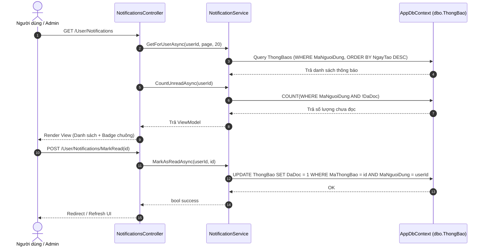
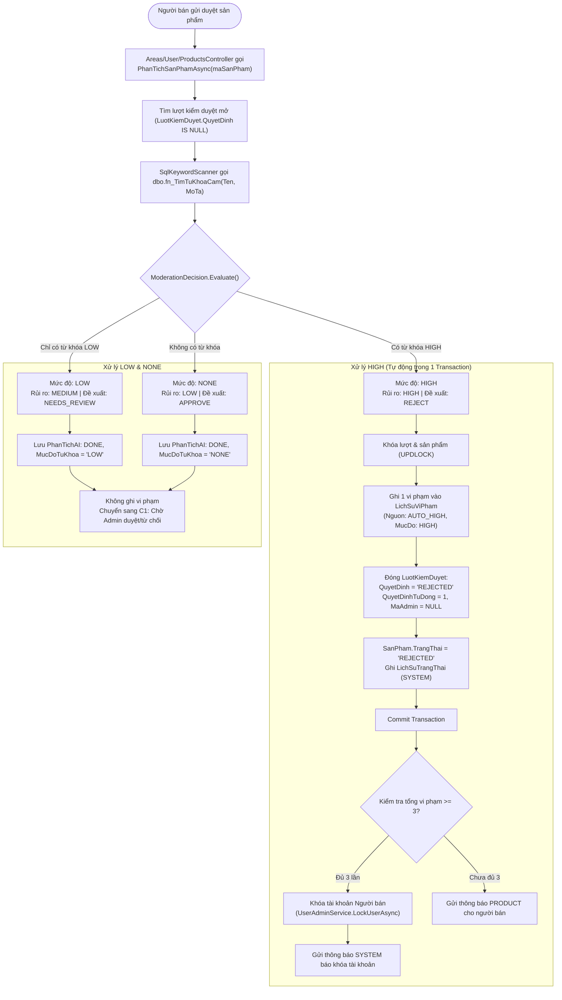
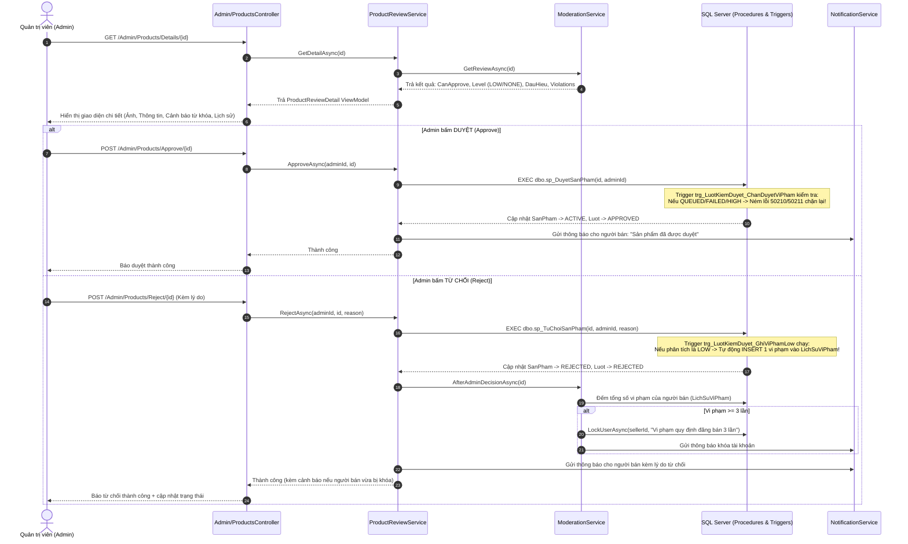
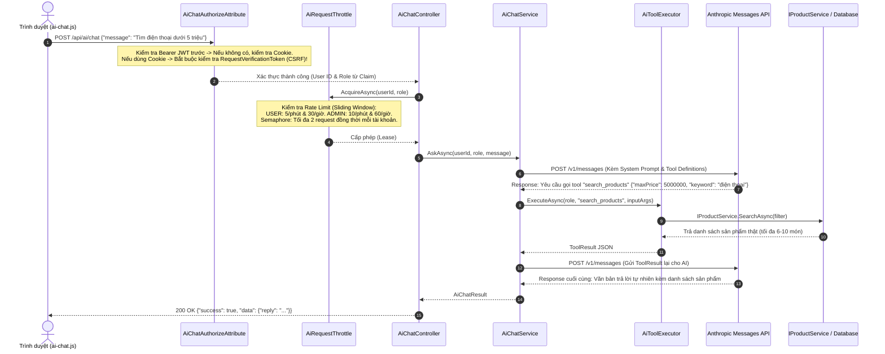
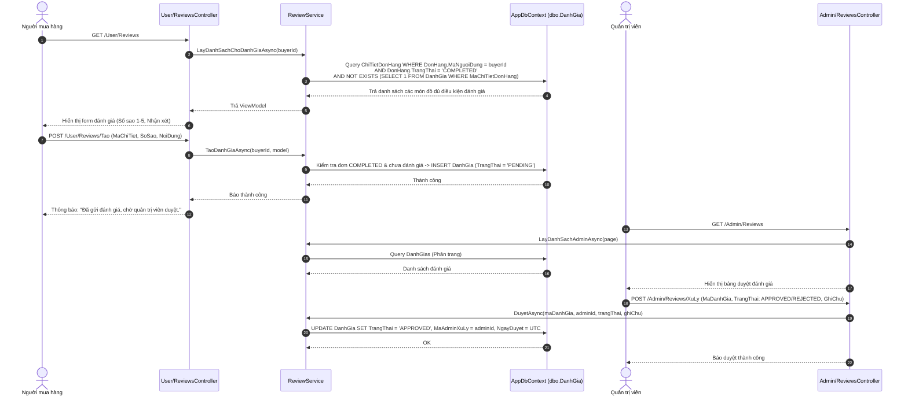
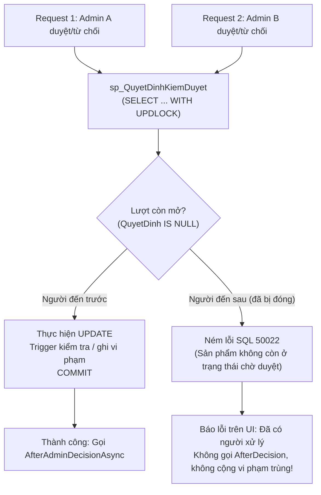

# Tài liệu Giải thích Toàn diện Kiến trúc & Luồng Nghiệp vụ Người C
## Dự án: Secondhand Marketplace (Chợ đồ cũ trực tuyến)
**Nền tảng:** ASP.NET Core MVC (.NET 10), SQL Server, Entity Framework Core (Data-First), Bootstrap 5, Anthropic Messages API.  
**Vai trò:** Người C — Phụ trách **Kiểm duyệt nội dung, Trợ lý AI, Đánh giá sau mua và Hệ thống Thông báo** (Tổng điểm: 25 điểm).

---

## Mục lục
1. [Tổng quan vai trò và ranh giới trách nhiệm của Người C](#1-tổng-quan-vai-trò-và-ranh-giới-trách-nhiệm-của-người-c)
2. [Tóm tắt 5 mảng công việc (C1 → C5)](#2-tóm-tắt-5-mảng-công-việc-c1--c5)
3. [Cơ sở dữ liệu & Các Script SQL liên quan](#3-cơ-sở-dữ-liệu--các-script-sql-liên-quan)
4. [Luồng nghiệp vụ và Thiết kế kỹ thuật chi tiết](#4-luồng-nghiệp-vụ-và-thiết-kế-kỹ-thuật-chi-tiết)
   - [4.1. C5 — Hệ thống Thông báo (Notification System)](#41-c5--hệ-thống-thông-báo-notification-system)
   - [4.2. C2 — Quản lý Từ khóa cấm & Phân tích Rule-Based](#42-c2--quản-lý-từ-khóa-cấm--phân-tích-rule-based)
   - [4.3. C1 — Admin Kiểm duyệt Sản phẩm & Quản lý Vi phạm](#43-c1--admin-kiểm-duyệt-sản-phẩm--quản-lý-vi-phạm)
   - [4.4. C3 — Chatbox AI Assistant (Anthropic Tool Use, Dual Auth, Rate Limit)](#44-c3--chatbox-ai-assistant-anthropic-tool-use-dual-auth-rate-limit)
   - [4.5. C4 — Hệ thống Đánh giá sau mua (Reviews)](#45-c4--hệ-thống-đánh-giá-sau-mua-reviews)
5. [Cơ chế Toàn vẹn dữ liệu, Xử lý đồng thời & Chống trùng lặp](#5-cơ-chế-toàn-vẹn-dữ-liệu-xử-lý-đồng-thời--chống-trùng-lặp)
6. [Ma trận Tích hợp: Hợp đồng giao tiếp giữa C và A, B, D, E](#6-ma-trận-tích-hợp-hợp-đồng-giao-tiếp-giữa-c-và-a-b-d-e)
7. [Kịch bản Kiểm thử & Hướng dẫn xác minh](#7-kịch-bản-kiểm-thử--hướng-dẫn-xác-minh)

---

## 1. Tổng quan vai trò và ranh giới trách nhiệm của Người C

Người C đóng vai trò **"người gác cổng chất lượng và trải nghiệm thông minh"** cho nền tảng thương mại điện tử đồ cũ:
- **Kiểm soát nội dung sản phẩm:** Ngăn chặn hàng cấm, hàng giả, gian lận thông qua cơ chế quét từ khóa tự động phân cấp mức độ (`HIGH`/`LOW`), cung cấp hàng chờ duyệt cho Quản trị viên (Admin).
- **Chế tài vi phạm:** Theo dõi lịch sử vi phạm của người bán, tự động khóa tài khoản khi người bán vi phạm đủ ngưỡng (3 lần vi phạm) để bảo vệ người mua.
- **Tương tác thông minh (AI):** Cung cấp Chatbox AI trợ giúp tìm kiếm sản phẩm, gợi ý thông minh và hỗ trợ người bán viết bài mô tả sản phẩm bằng cách kết nối trực tiếp với dữ liệu DB thật qua Function Calling.
- **Hậu mãi & Uy tín (Review):** Cho phép người mua đánh giá (1-5 sao kèm nhận xét) sau khi đơn hàng hoàn tất, giúp xây dựng độ tin cậy của cửa hàng.
- **Truyền thông nội bộ (Notification):** Cung cấp dịch vụ thông báo dùng chung cho toàn bộ hệ thống (đơn hàng, kiểm duyệt, khóa tài khoản, thông báo hệ thống toàn sàn).

```mermaid
flowchart TB
    subgraph ClientLayer["Giao diện người dùng & Admin"]
        UI_User["User: Nhận thông báo, Đánh giá đơn hàng, Chatbot AI"]
        UI_Admin["Admin: Duyệt sản phẩm, Quản lý từ khóa cấm, Xem lịch sử vi phạm, Cấu hình AI"]
    end

    subgraph ControllerLayer["Controllers (MVC & API)"]
        C_Notify["User/Admin NotificationsController"]
        C_Review["User/Admin ReviewsController"]
        C_Keywords["Admin ForbiddenKeywordsController"]
        C_ReviewProd["Admin ProductsController & ViolationsController"]
        C_Ai["Api AiChatController & Admin AiSettingsController"]
    end

    subgraph ServiceLayer["Services (Business Logic)"]
        S_Notify["NotificationService"]
        S_Review["ReviewService"]
        S_Mod["ModerationService & ForbiddenKeywordService"]
        S_ProdRev["ProductReviewService"]
        S_Ai["AiChatService & AiToolExecutor & AiRequestThrottle"]
    end

    subgraph DBLayer["Database (SQL Server & Triggers)"]
        DB_Core["ThongBao, DanhGia, CauHinhAI"]
        DB_Mod["TuKhoaCam, PhanTichAI, LuotKiemDuyet, LichSuViPham"]
        DB_Triggers["Trigger trg_LuotKiemDuyet_ChanDuyetViPham\nTrigger trg_LuotKiemDuyet_GhiViPhamLow"]
    end

    UI_User --> C_Notify & C_Review & C_Ai
    UI_Admin --> C_Keywords & C_ReviewProd & C_Ai & C_Notify & C_Review
    
    C_Notify --> S_Notify
    C_Review --> S_Review
    C_Keywords --> S_Mod
    C_ReviewProd --> S_ProdRev
    C_Ai --> S_Ai

    S_ProdRev --> S_Mod & S_Notify
    S_Mod --> S_Notify

    S_Notify --> DB_Core
    S_Review --> DB_Core
    S_Ai --> DB_Core
    S_Mod --> DB_Mod
    S_ProdRev --> DB_Mod
    DB_Mod --> DB_Triggers
```



---

## 2. Tóm tắt 5 mảng công việc (C1 → C5)

| Mã | Tên mảng | Điểm | Trách nhiệm chính | File chính trong mã nguồn |
|:---|:---|:---:|:---|:---|
| **C5** | **Hệ thống Thông báo** | 4 | Viết `INotificationService` dùng chung; hiển thị chuông & số chưa đọc; trang danh sách thông báo người dùng; Admin gửi thông báo cá nhân / toàn sàn. | `Services/Notifications/` <br>`Areas/User/Controllers/NotificationsController.cs`<br>`Areas/Admin/Controllers/NotificationsController.cs` |
| **C2** | **Từ khóa cấm & Phân tích sản phẩm** | 4 | CRUD từ khóa cấm phân cấp `HIGH`/`LOW`; hàm `PhanTichSanPhamAsync` quét tên/mô tả qua SQL `fn_TimTuKhoaCam`; tự động từ chối & phạt vi phạm nếu có `HIGH`; gắn cờ chờ duyệt nếu chỉ có `LOW`. | `Services/Moderation/`<br>`Areas/Admin/Controllers/ForbiddenKeywordsController.cs`<br>`database/15_kiemduyet_tukhoa.sql` → `18_...` |
| **C1** | **Admin kiểm duyệt sản phẩm & Vi phạm** | 5 | Hàng chờ duyệt (`vw_SanPhamChoDuyet`); xem chi tiết & cảnh báo từ C2; duyệt (`sp_DuyetSanPham`) hoặc từ chối (`sp_TuChoiSanPham`); gỡ sản phẩm vi phạm; tính 1 vi phạm khi từ chối LOW; tự động khóa tài khoản khi đạt ngưỡng 3 vi phạm; xem lịch sử vi phạm. | `Services/ProductReview/`<br>`Areas/Admin/Controllers/ProductsController.cs`<br>`Areas/Admin/Controllers/ViolationsController.cs` |
| **C3** | **Chatbox AI Assistant** | 6 | Gọi Anthropic Messages API với Tool Use (`search_products`, `recommend_products`, `draft_product_description`); xác thực kép JWT & Cookie CSRF; Rate limit (phút/giờ) & Concurrency Throttle (2 slots); Admin cấu hình model/prompt lưu bảng `CauHinhAI`. | `Services/Ai/`<br>`Controllers/Api/AiChatController.cs`<br>`Areas/Admin/Controllers/AiSettingsController.cs`<br>`wwwroot/js/ai-chat.js`, `_AiChatWidget.cshtml` |
| **C4** | **Đánh giá sau mua (Reviews)** | 6 | Tạo bảng `DanhGia` (1–5 sao, nhận xét); người mua đánh giá các món trong đơn hàng đã `COMPLETED` (mỗi món 1 lần); hiển thị đánh giá & điểm sao trung bình; Admin kiểm duyệt / ẩn đánh giá vi phạm. | `Services/Reviews/`<br>`Areas/User/Controllers/ReviewsController.cs`<br>`Areas/Admin/Controllers/ReviewsController.cs`<br>`database/11_danhgia.sql` |

---

## 3. Cơ sở dữ liệu & Các Script SQL liên quan

Người C quản lý và sử dụng các bảng, hàm, thủ tục và trigger sau:

### 3.1. Các bảng dữ liệu (Tables)
1. **`dbo.ThongBao`** (từ `02_create_tables.sql`):
   - Cột: `MaThongBao`, `MaNguoiDung`, `Loai` (`ORDER`, `PRODUCT`, `SYSTEM`), `TieuDe`, `NoiDung`, `MaThamChieu`, `DaDoc`, `NgayTao`.
2. **`dbo.TuKhoaCam`** (mở rộng bởi `15_kiemduyet_tukhoa.sql`):
   - Thêm cột `MucDo varchar(4)`: Ràng buộc `CHECK (MucDo IN ('LOW', 'HIGH'))`, mặc định `'LOW'`.
3. **`dbo.PhanTichAI`** (mở rộng bởi `15_kiemduyet_tukhoa.sql`):
   - Thêm cột `MucDoTuKhoa varchar(4)`: `CHECK (MucDoTuKhoa IS NULL OR MucDoTuKhoa IN ('NONE', 'LOW', 'HIGH'))`.
   - Đã có sẵn ràng buộc `UNIQUE(MaLuotKiemDuyet)`.
4. **`dbo.LichSuViPham`** (tạo mới trong `15_kiemduyet_tukhoa.sql`):
   - Cột: `MaViPham`, `MaNguoiBan`, `MaSanPham`, `MaLuotKiemDuyet`, `MucDo` (`LOW`/`HIGH`), `NguonGhiNhan` (`AUTO_HIGH`/`ADMIN_TU_CHOI_LOW`), `ChiTietTuKhoa` (JSON), `MaQuanTriVien`, `ThoiGian`.
   - Khóa duy nhất: `CONSTRAINT UX_LichSuViPham_Luot UNIQUE (MaLuotKiemDuyet)` — **Đảm bảo mỗi lượt kiểm duyệt chỉ có tối đa 1 vi phạm**.
5. **`dbo.LuotKiemDuyet`** (sửa đổi trong `16_luot_kiem_duyet_tu_choi_he_thong.sql`):
   - Thêm cột `QuyetDinhTuDong bit NOT NULL DEFAULT 0`.
   - Nới lỏng ràng buộc `CK_LuotKiemDuyet_DaQuyetDinh`: Cho phép `MaQuanTriVien` là `NULL` khi và chỉ khi `QuyetDinhTuDong = 1` và `QuyetDinh = 'REJECTED'` (hệ thống tự động từ chối).
6. **`dbo.DanhGia`** (tạo mới trong `11_danhgia.sql`):
   - Cột: `MaDanhGia`, `MaDonHang`, `MaChiTietDonHang` (`UNIQUE`), `MaNguoiMua`, `MaCuaHang`, `SoSao` (`CHECK 1..5`), `NoiDung`, `TrangThai` (`PENDING`, `APPROVED`, `REJECTED`), `MaAdminXuLy`, `GhiChuAdmin`, `NgayTao`, `NgayDuyet`.
7. **`dbo.CauHinhAI`** (tạo mới trong `20_cauhinh_ai.sql`):
   - Bảng đơn dòng (`MaCauHinhAI = 1`): `DangBat bit`, `TenModel varchar(100)`, `SystemPrompt nvarchar(4000)`, `MaNguoiCapNhat`, `NgayCapNhat`.

### 3.2. Stored Procedures & Functions
- **`dbo.fn_TimTuKhoaCam(@NoiDung)`** (trong `07_functions.sql`): Tách từ, chuẩn hóa và tìm các từ khóa cấm đang kích hoạt (`DangApDung = 1`) có mặt trong văn bản.
- **`dbo.fn_KiemTraRuleSanPham`** (sửa trong `17_bo_chan_tu_cam_khi_gui_duyet.sql`): Loại bỏ logic chặn từ khóa cấm ngay lúc người bán bấm "Gửi duyệt", để sản phẩm có thể vào trạng thái `PENDING_REVIEW` cho C2 phân tích.
- **`dbo.sp_DuyetSanPham` & `dbo.sp_TuChoiSanPham`** (trong `06_procedures.sql`): Khóa dòng lượt kiểm duyệt (`UPDLOCK`), gọi `sp_QuyetDinhKiemDuyet` để cập nhật trạng thái lượt và sản phẩm.

### 3.3. Database Triggers bảo đảm toàn vẹn
- **`trg_LuotKiemDuyet_ChanDuyetViPham`** (trong `15_kiemduyet_tukhoa.sql`):
  Chặn Admin duyệt (ném lỗi `50210`/`50211`) nếu:
  + Sản phẩm chưa được phân tích xong (`PhanTichAI` đang `QUEUED`, `FAILED`, hoặc chưa quét).
  + Sản phẩm có kết quả `HIGH` hoặc lượt đã bị ghi nhận vi phạm.
- **`trg_LuotKiemDuyet_GhiViPhamLow`** (trong `18_ghi_vi_pham_low_khi_tu_choi.sql`):
  Trigger `AFTER UPDATE` trên `LuotKiemDuyet`: Khi Admin từ chối sản phẩm (`REJECTED`, có `MaQuanTriVien`, `QuyetDinhTuDong = 0`) mà lượt phân tích có `MucDoTuKhoa = 'LOW'` và chưa từng có vi phạm, trigger **tự động chèn 1 dòng vào `LichSuViPham` ngay trong cùng transaction**.

---

## 4. Luồng nghiệp vụ và Thiết kế kỹ thuật chi tiết

---

### 4.1. C5 — Hệ thống Thông báo (Notification System)

Hệ thống thông báo nội bộ hỗ trợ thông tin xuyên suốt toàn sàn giữa Người mua, Người bán và Quản trị viên.



#### Phân tích chi tiết mã nguồn:
- **Nguyên tắc an toàn DbContext (`EnsureNoPendingChanges`):** `NotificationService` dùng chung scoped `AppDbContext`. Trước khi ghi thông báo, service kiểm tra `db.ChangeTracker.HasChanges()`. Nếu nơi gọi còn thay đổi chưa lưu, service ném lỗi ngay lập tức để tránh việc lưu dở dang dữ liệu nghiệp vụ của nơi gọi.
- **Tự động cô lập lỗi (`TrySaveAsync`):** Khi `SaveChangesAsync` gặp `DbUpdateException`, service tự động `Detach` các entity vừa thêm ra khỏi ChangeTracker để không làm crash các thao tác tiếp theo.
- **Admin gửi toàn sàn (`CreateForAllUsersAsync`):** Lấy danh sách toàn bộ người dùng `ACTIVE`, batch insert vào `ThongBao` trong đúng 1 transaction duy nhất (hoặc gửi đủ cho tất cả hoặc không gửi ai).
- **Tránh trùng lặp với Stored Procedure SQL:** Các Stored Procedure `sp_TaoDonHangTheoShop` và `sp_CapNhatTrangThaiDon` trong database đã tự sinh thông báo loại `ORDER`. Tầng C# chỉ gọi `CreateAsync` cho các sự kiện: duyệt/từ chối sản phẩm, gỡ sản phẩm, thông báo vi phạm, đấu giá, thông báo từ Admin.

---

### 4.2. C2 — Quản lý Từ khóa cấm & Phân tích Rule-Based

Nghiệp vụ phân tích sản phẩm hoàn toàn là **Rule-Based** (dựa trên từ khóa cấm được phân cấp `HIGH` và `LOW`), không gọi mô hình AI ngoài, nhưng lưu kết quả vào bảng `PhanTichAI` để tương thích mở rộng tương lai.



#### Quy tắc quyết định phân tích:
1. **Mức HIGH:**
   - Chỉ cần chứa ≥ 1 từ khóa `HIGH` (dù có thêm từ khóa `LOW` hay không).
   - Hệ thống tự động từ chối ngay lập tức, chuyển trạng thái sản phẩm sang `REJECTED`.
   - Ghi đúng 1 bản ghi vào `LichSuViPham` (`NguonGhiNhan = 'AUTO_HIGH'`).
   - Lượt kiểm duyệt được đóng tự động với `QuyetDinhTuDong = 1` và `MaQuanTriVien = NULL`.
2. **Mức LOW:**
   - Chỉ chứa từ khóa `LOW`, không có `HIGH`.
   - Lưu kết quả vào `PhanTichAI` với trạng thái `DONE`, `MucDoTuKhoa = 'LOW'`.
   - **Tuyệt đối không tự từ chối, không ghi vi phạm ngay.** Sản phẩm tiếp tục nằm ở hàng chờ để Admin đưa ra quyết định tại C1.
3. **Mức NONE:**
   - Không chứa bất kỳ từ khóa cấm nào. Kết quả lưu `DONE`, `MucDoTuKhoa = 'NONE'`. Admin duyệt/từ chối bình thường.
4. **Trường hợp lỗi (FAILED):**
   - Nếu quá trình quét gặp exception kỹ thuật, lưu `PhanTichAI.TrangThai = 'FAILED'`. Cho phép quét lại khi người bán cập nhật hoặc gửi lại.

---

### 4.3. C1 — Admin Kiểm duyệt Sản phẩm & Quản lý Vi phạm

Màn hình Quản trị viên tại `Areas/Admin/Controllers/ProductsController` kết nối chặt chẽ với kết quả từ C2.



#### Ma trận quyết định tại C1:

| Trạng thái phân tích C2 | Nút Duyệt | Nút Từ chối | Hành vi ghi nhận vi phạm |
|:---|:---:|:---:|:---|
| **NONE** (Không từ khóa) | Cho phép | Cho phép | Không ghi vi phạm. |
| **LOW** (Chứa từ khóa LOW) | Cho phép | Cho phép | **Nếu Duyệt:** 0 vi phạm.<br>**Nếu Từ chối:** Tự động ghi **1 vi phạm** (trigger `trg_LuotKiemDuyet_GhiViPhamLow`). |
| **HIGH** (Chứa từ khóa HIGH) | **Chặn** | **Chặn** | C2 đã tự động từ chối và ghi 1 vi phạm ngay từ đầu. Lượt kiểm duyệt đã đóng, không xuất hiện ở hàng chờ Admin. |
| **QUEUED / FAILED / Chưa quét** | **Chặn** (lỗi 50210) | Cho phép | Từ chối không tính vi phạm vì kết quả phân tích chưa hoàn tất. |

#### Chức năng Gỡ sản phẩm vi phạm (`RemoveProductAsync`):
- Cho phép Admin chủ động gỡ sản phẩm đang bán (`ACTIVE`) khi phát hiện vi phạm thực tế hoặc nhận kết quả xử lý từ Người D (Module Báo cáo vi phạm D5).
- Chuyển trạng thái sản phẩm sang `REMOVED` qua `sp_ChuyenTrangThaiSanPham`, ghi nhật ký `REMOVE_PRODUCT` và gửi thông báo cho người bán. Không tự động cộng vi phạm kiểm duyệt (trừ khi có quyết định xử lý báo cáo riêng).

---

### 4.4. C3 — Chatbox AI Assistant (Anthropic Tool Use, Dual Auth, Rate Limit)

Trợ lý thông minh cho sàn đồ cũ, tích hợp công nghệ Function Calling (Tool Use) của Claude/Anthropic Messages API, bảo đảm AI không truy cập trực tiếp hay phá hoại dữ liệu DB.



#### Các thành phần kỹ thuật nổi bật của C3:
1. **Xác thực lai (Dual-Scheme Authorization & CSRF):**
   - `AiChatAuthorizeAttribute`: Cho phép cả JWT (`Bearer`) và Web Cookie (`Cookies`).
   - Nếu xác thực bằng Cookie, bắt buộc kiểm tra Header `RequestVerificationToken` thông qua `IAntiforgery`. Người chưa đăng nhập nhận `401 Unauthorized` JSON thay vì bị redirect sang trang Login HTML.
2. **Kiểm soát chi phí & Tần suất gọi (`AiRequestThrottle`):**
   - Sử dụng thuật toán cửa sổ trượt (Sliding Window) độc lập theo từng tài khoản:
     + Role `USER`: 5 yêu cầu/phút, 30 yêu cầu/giờ.
     + Role `ADMIN`: 10 yêu cầu/phút, 60 yêu cầu/giờ.
   - Kiểm soát đồng thời: Dùng `SemaphoreSlim(2)` cho mỗi User ID. Nếu quá 2 yêu cầu cùng lúc, yêu cầu thứ 3 phải đợi tối đa 30s. Nếu hết thời gian chờ, API trả `429 Too Many Requests` kèm Header `Retry-After`.
3. **An toàn dữ liệu với 3 Tools cố định (`AiToolExecutor`):**
   - `search_products`: Tìm kiếm sản phẩm thật đang bán (`ACTIVE`).
   - `recommend_products`: Gợi ý sản phẩm theo khoảng giá và danh mục.
   - `draft_product_description`: Hỗ trợ người bán soạn mô tả sản phẩm (chỉ mở cho role `USER`).
   - AI tuyệt đối **không có quyền chạy SQL thô**, không thể truy cập bảng người dùng, mật khẩu hay thay đổi bất kỳ bản ghi nào trong database.
4. **Bảo mật API Key:**
   - Khóa API cấu hình qua `User Secrets` (`Ai:ApiKey`) hoặc biến môi trường `Ai__ApiKey`, không lưu trong code hay database.
   - Admin có màn hình `AiSettingsController` để bật/tắt chatbox, đổi Model hoặc cập nhật System Prompt trong bảng `CauHinhAI`.

---

### 4.5. C4 — Hệ thống Đánh giá sau mua (Reviews)

Đảm bảo độ tin cậy và minh bạch của các cửa hàng trên sàn đồ cũ.



#### Quy tắc nghiệp vụ đánh giá:
- **Điều kiện đánh giá:** Chỉ người mua sở hữu đơn hàng có trạng thái `COMPLETED` mới được đánh giá.
- **Tính duy nhất:** Mỗi món đồ trong đơn (`MaChiTietDonHang`) chỉ được đánh giá duy nhất một lần (ràng buộc `UX_DanhGia_ChiTiet`).
- **Trạng thái phê duyệt:** Đánh giá mới tạo có trạng thái `PENDING`. Sau khi Admin duyệt (`APPROVED`), đánh giá mới được hiển thị công khai trên trang chi tiết sản phẩm và hồ sơ Cửa hàng (phục vụ tính sao trung bình cho Người B).

---

## 5. Cơ chế Toàn vẹn dữ liệu, Xử lý đồng thời & Chống trùng lặp

Một trong những yêu cầu khắt khe nhất của đồ án là tính toàn vẹn dữ liệu khi có nhiều thao tác đồng thời (Concurrency):



### 3 Lớp bảo vệ chống trùng lặp vi phạm (Defense-in-Depth):
1. **Tầng Ứng dụng C# (`ModerationService` & `ProductReviewService`):**
   - Khóa dòng bi quan trên SQL Server (`WITH (UPDLOCK, ROWLOCK)`) đối với bản ghi `LuotKiemDuyet` và `SanPham`.
   - Kiểm tra điều kiện `!await db.LichSuViPhams.AnyAsync(...)` trước khi thêm bản ghi vi phạm.
2. **Tầng Stored Procedure & Trigger SQL:**
   - Trigger `trg_LuotKiemDuyet_GhiViPhamLow` sử dụng mệnh đề `WHERE NOT EXISTS (SELECT 1 FROM dbo.LichSuViPham WHERE MaLuotKiemDuyet = i.MaLuotKiemDuyet)`.
   - Toàn bộ thao tác cập nhật quyết định và ghi vi phạm LOW nằm trọn vẹn trong **cùng 1 Database Transaction**. Nếu trigger lỗi, quyết định từ chối bị rollback theo.
3. **Tầng Ràng buộc Database (Schema Constraints):**
   - `CONSTRAINT UX_LichSuViPham_Luot UNIQUE (MaLuotKiemDuyet)`: Đảm bảo ở cấp độ vật lý đĩa cứng, không bao giờ có 2 dòng vi phạm cho cùng một lượt kiểm duyệt. Nếu có 2 transaction lọt qua logic C#, SQL Server sẽ ném lỗi vi phạm Unique Key (`2601`/`2627`), C# bắt lỗi này và hoàn tác an toàn.

### Quy tắc khóa tài khoản tự động:
- Ngưỡng khóa: `ModerationPolicy.ViolationLockThreshold = 3` (được định nghĩa tập trung).
- Sử dụng chung một bộ đếm vi phạm cho mỗi người bán: `COUNT(*) FROM LichSuViPham WHERE MaNguoiBan = @SellerId` (tính cả `AUTO_HIGH` và `ADMIN_TU_CHOI_LOW`).
- **Ngoại lệ:** Tuyệt đối không khóa tài khoản có vai trò `ADMIN`.
- **Bảo toàn lịch sử:** Việc Quản trị viên mở khóa tài khoản thủ công (chức năng của Người A) **không xóa** lịch sử vi phạm trong `LichSuViPham`.

---

## 6. Ma trận Tích hợp: Hợp đồng giao tiếp giữa C và A, B, D, E

| Thành viên | Chiều gọi | Giao tiếp / Service | Chi tiết hợp đồng |
|:---|:---:|:---|:---|
| **Người B** <br>*(Sản phẩm)* | B → C | `IModerationService.PhanTichSanPhamAsync` | Ngay sau khi người bán bấm gửi duyệt (`sp_GuiDuyetSanPham`), B gọi hàm này để quét từ khóa. Sản phẩm có thể chuyển sang `REJECTED` ngay nếu gặp `HIGH`. |
| **Người B** <br>*(Giao diện)* | B ↔ C | `Views/Shared/_AiChatWidget.cshtml` & `_Layout.cshtml` | B chèn partial widget chatbox AI và chuông thông báo vào Layout chung. C cung cấp các điểm sao đánh giá từ C4 để B hiển thị lên Card sản phẩm và trang Shop. |
| **Người A** <br>*(Tài khoản)* | C → A | `IUserAdminService.LockUserAsync` | Khi người bán chạm ngưỡng 3 vi phạm, C gọi service của A để khóa tài khoản người bán với lý do tự động. |
| **Người A** <br>*(Nhật ký)* | C → A | `IAuditLogService.GhiNhatKyAsync` | C ghi nhật ký quản trị khi Admin thực hiện gỡ sản phẩm vi phạm (`REMOVE_PRODUCT`). |
| **Người D** <br>*(Mua hàng)* | D → C | `INotificationService.CreateAsync` | D gọi service thông báo khi người mua đặt hàng, thanh toán, đổi trạng thái tranh chấp. |
| **Người D** <br>*(Đánh giá)* | D → C | `ChiTietDonHang` & `DonHang` | C4 đọc trạng thái đơn hàng của D (`TrangThai == 'COMPLETED'`) để mở quyền đánh giá cho người mua. |
| **Người D** <br>*(Báo cáo)* | D → C | `IProductReviewService.RemoveProductAsync` | Khi Admin xử lý báo cáo vi phạm ở D5 và quyết định gỡ sản phẩm, D5 gọi trực tiếp hàm này của C1. |
| **Người E** <br>*(Bán hàng & Đấu giá)* | E → C | `INotificationService.CreateAsync` | E gọi thông báo khi người bán xác nhận/giao hàng hoặc khi phiên đấu giá kết thúc tìm ra người thắng. |

---

## 7. Kịch bản Kiểm thử & Hướng dẫn xác minh

### 7.1. Chuẩn bị Cơ sở dữ liệu
Chạy các script SQL theo đúng thứ tự (đã được cấu hình trong `run-db.bat`):
```bat
sqlcmd -S localhost -d SecondHandMarketplace -i database\11_danhgia.sql
sqlcmd -S localhost -d SecondHandMarketplace -i database\15_kiemduyet_tukhoa.sql
sqlcmd -S localhost -d SecondHandMarketplace -i database\16_luot_kiem_duyet_tu_choi_he_thong.sql
sqlcmd -S localhost -d SecondHandMarketplace -i database\17_bo_chan_tu_cam_khi_gui_duyet.sql
sqlcmd -S localhost -d SecondHandMarketplace -i database\18_ghi_vi_pham_low_khi_tu_choi.sql
sqlcmd -S localhost -d SecondHandMarketplace -i database\20_cauhinh_ai.sql
```

### 7.2. Kịch bản kiểm thử các luồng trọng yếu
1. **Kiểm thử Quét từ khóa HIGH (Tự động từ chối & Phạt vi phạm):**
   - Admin vào `/Admin/ForbiddenKeywords`, thêm từ khóa `"vũ khí nguy hiểm"` với mức `HIGH`.
   - Người bán tạo sản phẩm có tên hoặc mô tả chứa `"vũ khí nguy hiểm"`, bấm Gửi duyệt.
   - **Kết quả kỳ vọng:** Sản phẩm lập tức chuyển sang trạng thái `REJECTED`, xuất hiện 1 dòng trong `LichSuViPham` (`NguonGhiNhan = 'AUTO_HIGH'`), người bán nhận được thông báo giải thích lý do từ chối. Không xuất hiện ở hàng chờ Admin C1.
2. **Kiểm thử Quét từ khóa LOW (Chờ Admin & Phạt khi từ chối):**
   - Admin thêm từ khóa `"chuyển khoản ngoài"` với mức `LOW`.
   - Người bán đăng sản phẩm chứa `"chuyển khoản ngoài"`, bấm Gửi duyệt.
   - **Kết quả kỳ vọng:** Sản phẩm nằm ở trạng thái `PENDING_REVIEW`. Admin vào `/Admin/Products/Details/{id}` thấy cảnh báo màu vàng mức `LOW`.
   - **Trường hợp Admin DUYỆT:** Sản phẩm chuyển `ACTIVE`, không có bản ghi vi phạm nào được tạo.
   - **Trường hợp Admin TỪ CHỐI:** Sản phẩm chuyển `REJECTED`, trigger `trg_LuotKiemDuyet_GhiViPhamLow` tự động tạo 1 bản ghi trong `LichSuViPham`.
3. **Kiểm thử Tự động khóa tài khoản khi đạt ngưỡng 3 vi phạm:**
   - Tiếp tục thực hiện từ chối các sản phẩm vi phạm của cùng người bán đó cho đến khi đủ 3 lần.
   - **Kết quả kỳ vọng:** Sau lần từ chối thứ 3, tài khoản người bán tự động chuyển sang `TrangThai = 'LOCKED'`. Người bán không thể đăng nhập hoặc thao tác trên sàn.
4. **Kiểm thử Chatbox AI & Bảo vệ CSRF / Rate Limit:**
   - Cấu hình khóa API trong User Secrets: `dotnet user-secrets set "Ai:ApiKey" "sk-ant-api..."`.
   - Đăng nhập tài khoản User, mở widget Chatbox ở góc phải màn hình.
   - Hỏi: *"Tìm giúp tôi điện thoại dưới 5 triệu"*. AI gọi tool `search_products` và trả lời dựa trên sản phẩm thật trong DB.
   - Gửi liên tục > 5 tin nhắn trong vòng 1 phút.
   - **Kết quả kỳ vọng:** Hệ thống trả về mã lỗi HTTP `429 Too Many Requests`, widget hiển thị thông báo yêu cầu chờ cùng số giây đếm ngược (`Retry-After`).
5. **Kiểm thử Đánh giá sau mua (C4):**
   - Dùng tài khoản người mua có đơn hàng trạng thái `COMPLETED`.
   - Truy cập `/User/Reviews`, điền số sao (5 sao) và nhận xét.
   - **Kết quả kỳ vọng:** Đánh giá được lưu ở trạng thái `PENDING`. Không thể gửi đánh giá lần 2 cho cùng món hàng đó.
   - Đăng nhập Admin vào `/Admin/Reviews`, bấm Duyệt (`APPROVED`). Đánh giá được hiển thị công khai trên trang sản phẩm.
