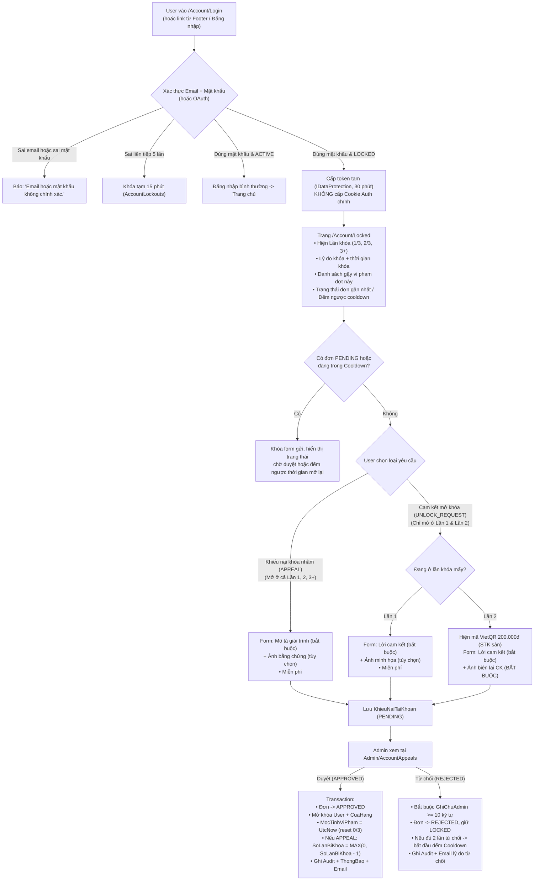

# Thiết kế Nghiệp vụ & Kế hoạch Triển khai — Khiếu nại, Mở khóa Tài khoản & Sửa Bộ đếm 3 Gậy

> **Dự án:** Sàn giao dịch đồ cũ Re:Market (`SecondHandMarketplace`)  
> **Phụ trách:** Người C (bổ sung theo thỏa thuận nhóm)  
> **Trạng thái:** Đã chốt thiết kế nghiệp vụ — Chưa triển khai code  
> **Tác động tới thành viên khác:** Độc lập, không bị chặn bởi task nào; chỉ có vài điểm đụng nhẹ file dùng chung (liệt kê ở Mục 6)

---

## Tóm tắt nhanh Logic Nghiệp vụ

1. **Tách rõ 2 loại yêu cầu cho tài khoản bị khóa (`LOCKED`):**
   - **Khiếu nại khóa nhầm (`APPEAL`):** Người dùng không nhận lỗi (cho rằng hệ thống quét nhầm / bị báo cáo oan). Kèm mô tả giải trình + ảnh bằng chứng (**tùy chọn**). **Không thu phí** kể cả ở lần khóa thứ 2; nếu Admin duyệt sẽ mở khóa, reset gậy về `0/3` và **giảm `SoLanBiKhoa - 1`** (xóa tiền án lần bị oan).
   - **Cam kết mở khóa (`UNLOCK_REQUEST`):** Người dùng nhận lỗi vi phạm, cam kết không tái phạm và xin mở lại tài khoản. Nếu Admin duyệt sẽ mở khóa, reset gậy về `0/3` và **giữ nguyên `SoLanBiKhoa`**.
2. **Chính sách leo thang 3 lần khóa (`SoLanBiKhoa`):**
   - **Lần 1 (`SoLanBiKhoa = 1`):** Mở cả 2 nút; *Cam kết mở khóa* **miễn phí** (ảnh tùy chọn).
   - **Lần 2 (`SoLanBiKhoa = 2`):** *Khiếu nại khóa nhầm* vẫn miễn phí; *Cam kết mở khóa* yêu cầu **phí xử lý / ký quỹ cam kết 200.000đ** qua mã **VietQR** (tái sử dụng `VietQrGenerator` với STK của Sàn) và **bắt buộc đính kèm ảnh biên lai chuyển khoản**.
   - **Lần 3+ (`SoLanBiKhoa >= 3`):** Khóa mức cao nhất — **tắt nút *Cam kết mở khóa***, chỉ chừa nút **Khiếu nại khóa nhầm / Yêu cầu xem xét đặc biệt** phòng trường hợp hệ thống khóa oan.
3. **Giới hạn gửi & Cooldown do Admin cấu hình:**
   - Tại một thời điểm chỉ được có **tối đa 1 đơn `PENDING`** (đang chờ duyệt thì khóa form).
   - Trong mỗi chu kỳ gửi, tối đa **2 lần gửi** (`SoLanGuiMoiChuKy`, mặc định `2`). Nếu bị từ chối đủ 2 lần, hệ thống khóa nút gửi theo **Cooldown** (`CooldownPhut`, Admin chỉnh trực tiếp theo **Ngày / Giờ / Phút** trên giao diện — mặc định 3 ngày, khi test/demo có thể chỉnh 1 phút). Hết Cooldown tự mở lại chu kỳ 2 lượt mới.
4. **Sửa triệt để bug "mở khóa xong bị auto-ban lại":**
   - Thêm cột `MocTinhViPham` trên `NguoiDung`. Mỗi lần mở khóa (dù Admin duyệt đơn hay bấm mở tay ở `Admin/Users`), gán `MocTinhViPham = UtcNow`.
   - Bộ đếm 3 gậy ở cả `ModerationService` và `ReportService` chỉ đếm vi phạm phát sinh **sau `MocTinhViPham`** → reset hiệu lực về **`0/3`**, đồng thời **giữ nguyên 100% lịch sử vi phạm** để audit.
5. **Cửa vào & Bảo mật đăng nhập:**
   - Giữ nguyên cơ chế không cho acc `LOCKED` đăng nhập vào phiên chính (`OnValidatePrincipal` đá phiên ngay).
   - Khi nhập **đúng email + mật khẩu** của acc `LOCKED` (hoặc OAuth thành công), chuyển thẳng sang `/Account/Locked` bằng token tạm (`IDataProtectionProvider`, hiệu lực 30 phút) để xem lý do khóa, lịch sử gậy và gửi yêu cầu.
   - Khi **sai email hoặc sai mật khẩu** (dù acc `ACTIVE` hay `LOCKED`), chỉ báo thống nhất *"Email hoặc mật khẩu không chính xác."* (bỏ vế *"hoặc tài khoản đã bị khóa"* gây khó hiểu và tránh lộ trạng thái khóa cho người lạ).
   - Đặt thêm link dẫn tới luồng này tại trang **Đăng nhập** và **Footer (cột Hỗ trợ)**.

---

## 1. Hiện trạng & Vấn đề cần giải quyết

| Vấn đề hiện tại trong source | Tác động thực tế | Hướng xử lý |
| :--- | :--- | :--- |
| Chưa có bảng/luồng khiếu nại tài khoản bị khóa (mới chỉ có khiếu nại đơn hàng `TranhChap`). | User bị khóa bị đá phiên ngay, không biết rõ lý do khóa và không có chỗ gửi kháng cáo dù thông báo hệ thống bảo *"liên hệ quản trị viên"*. | Bổ sung trọn luồng User (`/Account/Locked`) + Admin (`Admin/AccountAppeals`). |
| `UserAdminService.UnlockUserAsync` chỉ đổi `TrangThai = "ACTIVE"`, không reset mốc đếm gậy. | `ModerationService.AfterAdminDecisionAsync` đếm toàn bộ `LichSuViPham` sau **mọi** quyết định kiểm duyệt (kể cả Admin **DUYỆT** sản phẩm hợp lệ) → acc vừa mở khóa xong lập tức bị **auto-ban lại**. | Thêm `MocTinhViPham` trên `NguoiDung`, lọc đếm gậy sau mốc này ở cả `ModerationService` & `ReportService`; chỉ enforce khóa ở `AfterAdminDecisionAsync` khi có vi phạm mới. |
| `AuthService.AuthenticateAsync` kiểm tra `TrangThai != "ACTIVE"` trước khi kiểm tra mật khẩu rồi trả `null` chung. | Trang Đăng nhập phải báo chung *"Email hoặc mật khẩu không chính xác, hoặc tài khoản đã bị khóa."* — vừa gây nhầm lẫn cho người gõ sai mật khẩu, vừa không cho chủ acc bị khóa xem lý do. | Thêm `AuthenticateWithStatusAsync` kiểm tra mật khẩu trước → đúng mật khẩu + `LOCKED` thì rẽ sang `/Account/Locked`. |
| Chưa phân biệt số lần bị khóa và chưa có điều kiện tái phạm lần 2 / lần 3. | Không có cơ chế răn đe người bán tái phạm nhiều lần. | Thêm `SoLanBiKhoa` trên `NguoiDung` + chính sách 3 nấc + bảng cấu hình động cho Admin. |

---

## 2. Chi tiết Nghiệp vụ

### 2.1. Luồng tổng quan

### 2.2. Bảng Trạng thái Đăng nhập (Chống lộ thông tin)

| Trường hợp nhập tại `/Account/Login` | Phản hồi của hệ thống |
| :--- | :--- |
| Email không tồn tại | *"Email hoặc mật khẩu không chính xác."* |
| Email tồn tại (`ACTIVE` hoặc `LOCKED`) nhưng **sai mật khẩu** | *"Email hoặc mật khẩu không chính xác."* |
| Nhập sai mật khẩu 5 lần liên tiếp | *"Bạn đã nhập sai mật khẩu quá nhiều lần. Vui lòng thử lại sau ít phút."* |
| Email tồn tại + **đúng mật khẩu** + `TrangThai == LOCKED` | Chuyển thẳng tới `/Account/Locked` (dùng token tạm, không cấp Cookie chính). |
| Email tồn tại + **đúng mật khẩu** + `TrangThai == ACTIVE` | Đăng nhập thành công bình thường. |

*(API `POST /api/auth/login` giữ nguyên `IAuthService.AuthenticateAsync` và contract cũ để không làm vỡ phía API/test hiện có.)*

### 2.3. Chính sách 3 lần khóa (`SoLanBiKhoa`)

| Lần khóa | Khiếu nại khóa nhầm (`APPEAL`) | Cam kết mở khóa (`UNLOCK_REQUEST`) |
| :--- | :--- | :--- |
| **Lần 1** (`SoLanBiKhoa = 1`) | Mở — miễn phí, ảnh tùy chọn. Duyệt → `SoLanBiKhoa` về `0`, reset gậy `0/3`. | Mở — miễn phí, ảnh tùy chọn. Duyệt → giữ `SoLanBiKhoa = 1`, reset gậy `0/3`. |
| **Lần 2** (`SoLanBiKhoa = 2`) | Mở — miễn phí, ảnh tùy chọn. Duyệt → `SoLanBiKhoa` về `1`, reset gậy `0/3`. | Mở — hiển thị **VietQR 200.000đ** (STK sàn), **bắt buộc ảnh biên lai CK**. Duyệt → giữ `SoLanBiKhoa = 2`, reset gậy `0/3`. |
| **Lần 3+** (`SoLanBiKhoa >= 3`) | Mở *(hiển thị nhãn "Khiếu nại khóa nhầm / Xem xét đặc biệt")* — miễn phí, ảnh tùy chọn. Duyệt → `SoLanBiKhoa - 1`, reset gậy `0/3`. | **Đóng hẳn** — không cho gửi cam kết mở khóa (tài khoản bị khóa mức vĩnh viễn do tái phạm 3 lần). |

### 2.4. Cơ chế Giới hạn gửi & Cooldown cấu hình động

- **Chống gửi chồng:** Unique Filtered Index đảm bảo mỗi user chỉ có tối đa **1 đơn `PENDING`** tại một thời điểm.
- **Chu kỳ gửi & Cooldown:**
  - Xét các đơn trong đợt khóa hiện tại (`NgayTao >= NguoiDung.ThoiGianKhoa`).
  - Mỗi chu kỳ user được gửi tối đa `SoLanGuiMoiChuKy` đơn (mặc định `2`, tính tổng cả `APPEAL` và `UNLOCK_REQUEST`).
  - Khi đủ `SoLanGuiMoiChuKy` đơn liên tiếp bị `REJECTED` (ví dụ lần 2, lần 4, ...), thời điểm mở lại = `NgayXuLy (đơn từ chối cuối cùng) + CooldownPhut`.
  - Trong khi `UtcNow < ThoiDiemMoLai`: khóa nút gửi và hiển thị đếm ngược rõ ràng cho user.
  - Khi `UtcNow >= ThoiDiemMoLai`: chu kỳ mới mở ra, user lại có tối đa `SoLanGuiMoiChuKy` lượt gửi tiếp.
  - Admin cấu hình trực tiếp `Cooldown` (nhập tách **Ngày / Giờ / Phút**), `SoLanGuiMoiChuKy`, `PhiMoKhoaLan2` và thông tin tài khoản VietQR của Sàn ngay trên trang quản trị.

### 2.5. Xử lý các Edge Case quan trọng

- **Admin mở khóa trực tiếp tại `Admin/Users/Unlock`:**
  - Vẫn set `MocTinhViPham = DateTime.UtcNow` (reset gậy về `0/3`).
  - Nếu user đang có đơn `KhieuNaiTaiKhoan` ở trạng thái `PENDING`, tự động chuyển đơn đó sang `APPROVED` với `GhiChuAdmin = "Tài khoản đã được mở khóa trực tiếp bởi quản trị viên."` để không bị treo đơn mồ côi.
- **Đồng bộ 2 nguồn đếm gậy:**
  - `ModerationService.GetViolationCountAsync`: chỉ đếm `LichSuViPham` có `ThoiGian > MocTinhViPham` (nếu `MocTinhViPham != null`).
  - `ReportService`: chỉ đếm `LichSuViPham` (`ThoiGian > MocTinhViPham`) và `BaoCao` `RESOLVED` (`NgayXuLy > MocTinhViPham`).
  - `ModerationService.AfterAdminDecisionAsync`: chỉ chạy `EnforceViolationThresholdAsync` khi lượt đó thực sự có ghi vi phạm (`recorded == true`).
- **Tài khoản đã từng bị `LOCKED` từ seed cũ (`locked@demo.local`):**
  - Khi migration chạy, những user đang `TrangThai = 'LOCKED'` và `SoLanBiKhoa = 0` được chuẩn hóa thành `SoLanBiKhoa = 1`.
- **Upload ảnh bằng chứng / biên lai:**
  - Lưu vào `wwwroot/uploads/appeals/`, chỉ cho phép `.jpg`, `.jpeg`, `.png`, `.webp`, tối đa 5 MB, đổi tên file bằng `Guid`, kiểm tra đường dẫn an toàn (`UrlAnToan.HopLe`) khi render.

---

## 3. Thiết kế Database

### 3.1. Bổ sung cột trên bảng `NguoiDung`

| Cột | Kiểu dữ liệu | Mặc định | Ý nghĩa |
| :--- | :--- | :--- | :--- |
| `MocTinhViPham` | `datetime2(3) NULL` | `NULL` | Thời điểm mở khóa gần nhất; chỉ các vi phạm sau mốc này mới tính vào bộ đếm 3 gậy. |
| `SoLanBiKhoa` | `int NOT NULL` | `0` | Tổng số đợt tài khoản bị chuyển `ACTIVE -> LOCKED` (giảm 1 nếu Admin duyệt `APPEAL` khóa nhầm). |

Constraint bổ sung: `CK_NguoiDung_SoLanBiKhoa CHECK (SoLanBiKhoa >= 0)`.

### 3.2. Bảng mới `KhieuNaiTaiKhoan`

| Cột | Kiểu dữ liệu | Ghi chú |
| :--- | :--- | :--- |
| `MaKhieuNai` | `int IDENTITY(1,1) PK` | Khóa chính |
| `MaNguoiDung` | `int NOT NULL FK -> NguoiDung` | Tài khoản gửi đơn |
| `LoaiYeuCau` | `varchar(20) NOT NULL` | `APPEAL` (Khiếu nại khóa nhầm) \| `UNLOCK_REQUEST` (Cam kết mở khóa) |
| `LanKhoaThu` | `int NOT NULL` | Snapshot `SoLanBiKhoa` tại thời điểm gửi đơn (1, 2, 3...) |
| `LyDoKhoaLucGui` | `nvarchar(500) NOT NULL` | Snapshot `NguoiDung.LyDoKhoa` tại thời điểm gửi |
| `NoiDung` | `nvarchar(2000) NOT NULL` | Nội dung giải trình / cam kết (tối thiểu 20 ký tự) |
| `BangChungAnh` | `varchar(500) NULL` | Đường dẫn ảnh bằng chứng hoặc biên lai CK (`/uploads/appeals/...`) |
| `YeuCauPhi` | `bit NOT NULL DEFAULT (0)` | `1` nếu là `UNLOCK_REQUEST` ở lần khóa thứ 2 |
| `SoTienPhi` | `decimal(18,2) NOT NULL DEFAULT (0)` | Snapshot mức phí tại thời điểm gửi (vd `200000`) |
| `MaGiaoDichThamChieu` | `varchar(40) NULL` | Nội dung CK chuẩn sinh cho VietQR (vd `MOKHOA U5 L2`) |
| `TrangThai` | `varchar(20) NOT NULL DEFAULT ('PENDING')` | `PENDING` \| `APPROVED` \| `REJECTED` |
| `GhiChuAdmin` | `nvarchar(1000) NULL` | Ghi chú/lý do duyệt hoặc từ chối của Admin |
| `NguoiXuLyId` | `int NULL FK -> NguoiDung` | Admin xử lý đơn |
| `NgayTao` | `datetime2(3) NOT NULL DEFAULT (SYSUTCDATETIME())` | Thời điểm gửi đơn |
| `NgayXuLy` | `datetime2(3) NULL` | Thời điểm Admin xử lý (làm mốc tính Cooldown nếu `REJECTED`) |

Index & Constraints quan trọng:
- `CK_KhieuNaiTaiKhoan_LoaiYeuCau CHECK (LoaiYeuCau IN ('APPEAL', 'UNLOCK_REQUEST'))`
- `CK_KhieuNaiTaiKhoan_TrangThai CHECK (TrangThai IN ('PENDING', 'APPROVED', 'REJECTED'))`
- `UQ_KhieuNaiTaiKhoan_DangCho`: `UNIQUE NONCLUSTERED INDEX (MaNguoiDung) WHERE TrangThai = 'PENDING'` (chống gửi trùng / race condition).
- `IX_KhieuNaiTaiKhoan_TrangThai_NgayTao` và `IX_KhieuNaiTaiKhoan_MaNguoiDung_NgayTao`.

### 3.3. Bảng cấu hình 1 dòng `CauHinhKhieuNaiTaiKhoan`

| Cột | Kiểu dữ liệu | Giá trị mặc định (Seed core) |
| :--- | :--- | :--- |
| `Id` | `int PK CHECK (Id = 1)` | `1` |
| `SoLanGuiMoiChuKy` | `int NOT NULL` | `2` |
| `CooldownPhut` | `int NOT NULL` | `4320` (3 ngày — Admin chỉnh theo Ngày/Giờ/Phút) |
| `PhiMoKhoaLan2` | `decimal(18,2) NOT NULL` | `200000` |
| `TenNganHang` | `nvarchar(100) NOT NULL` | `N'MB Bank'` |
| `MaNganHang` | `varchar(20) NOT NULL` | `'MB'` |
| `SoTaiKhoan` | `varchar(30) NOT NULL` | STK nhận phí của sàn (mẫu demo, Admin đổi trên UI) |
| `ChuTaiKhoan` | `nvarchar(100) NOT NULL` | `N'RE MARKET PLATFORM'` |
| `NgayCapNhat` | `datetime2(3) NOT NULL` | `SYSUTCDATETIME()` |
| `NguoiCapNhatId` | `int NULL FK -> NguoiDung` | `NULL` |

---

> **Phân công thực hiện:** Xem file phân chia công việc riêng giữa Người C và Người D (`phan-chia-cong-viec-khieu-nai-tai-khoan.md`).

---

## 4. Ghi chú phối hợp với nhóm (File dùng chung)

Các file sau sẽ có sửa đổi nhẹ — cần lưu ý khi merge nhánh:
- **Database:** `database/02_create_tables.sql`, `03_constraints_indexes.sql`, `12_seed_core.sql`, `13_seed_demo.sql` + file migration mới (nhắc thành viên chạy migration hoặc `reset-db` sau khi kéo code).
- **Nhóm A:** `Services/Auth/IAuthService.cs`, `AuthService.cs`, `Controllers/AccountController.cs`, `Views/Account/Login.cshtml`, `Services/Accounts/IUserAdminService.cs`, `UserAdminService.cs`, `Areas/Admin/Views/Users/Index.cshtml`.
- **Nhóm D:** `Services/Reports/ReportService.cs` (chỉ thêm điều kiện lọc theo `MocTinhViPham` ở đoạn cộng dồn 3 gậy; **không** sửa `_VietQRCard.cshtml`).
- **Dùng chung:** `Data/AppDbContext.cs`, `Common/Extensions/ServiceCollectionExtensions.cs`, `Views/Shared/_Layout.cshtml`, `Views/Shared/_AdminLinks.cshtml`.
